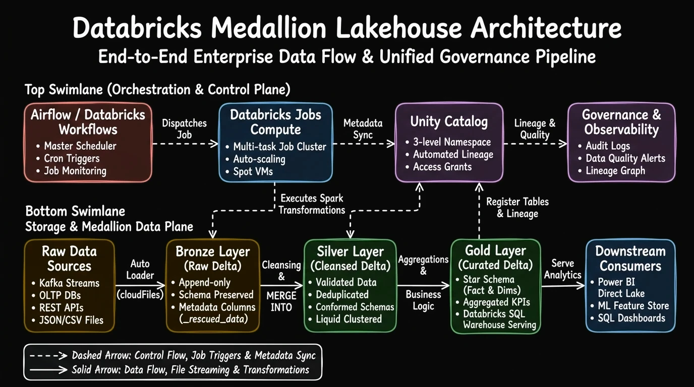
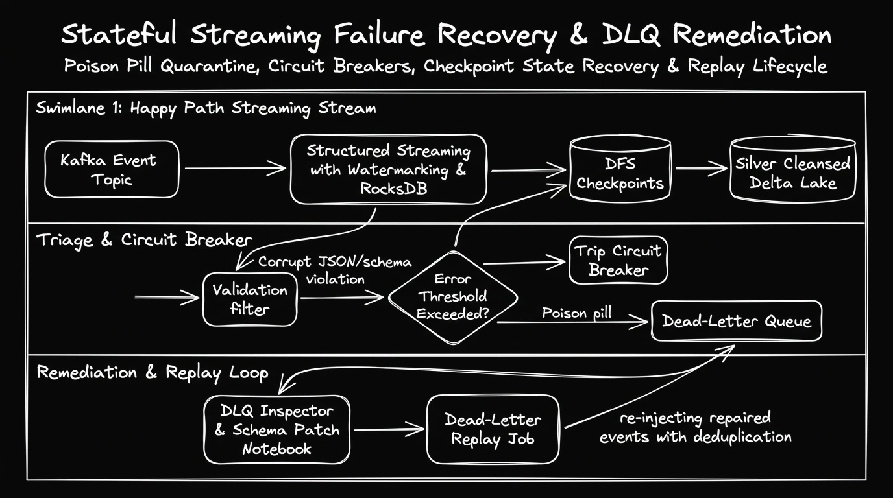
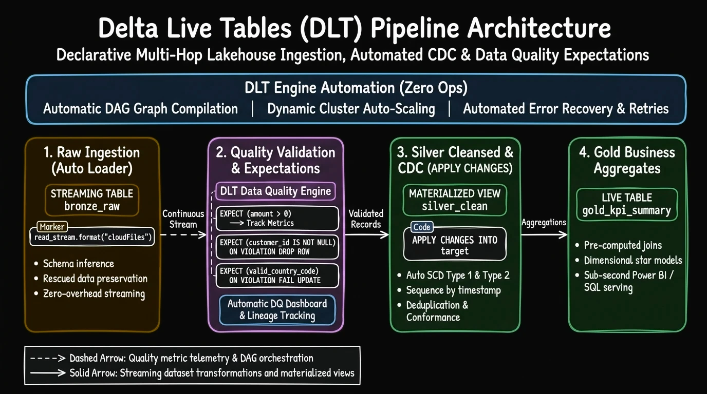

# Azure Databricks Production Project Blueprints
> **Senior Data Engineer & Lakehouse Architect Design Portfolio**

This repository contains end-to-end design blueprints, code implementations, and operational playbooks for building enterprise data platforms on Azure Databricks.

## 🧠 Core Curriculum Concepts & Topics (35 Architectural Topics Covered)

> 💡 **Enterprise Knowledge Base Integration**: Production architectural topics and lakehouse engine primitives implemented across the 3 project blueprints, cross-linked with the [Modern Data Engineering Systems Encyclopedia (921 Topics)](https://moderndataengineer.uk/concepts), arranged in increasing order of difficulty. Browse the full curriculum in [`topics/README.md`](topics/README.md).

### 📑 Project Topics Directory at a Glance

| Project Blueprint | Topic Count | Key Primitives Covered | Status |
|:---|:---:|:---|:---:|
| 🛒 **Scenario 1: Retail Sales & Inventory** | **12** | Auto Loader, Liquid Clustering, Deletion Vectors, SCD Type 2 | ✅ Documented |
| 💳 **Scenario 2: Payments Fraud & AML** | **12** | RocksDB State Store, Watermarks, Exactly-Once, Idempotent Egress | ✅ Documented |
| 🔄 **Scenario 3: Warehouse Modernization** | **11** | Expand/Contract Migration, Dual-Run Parity, DABs CI/CD | ✅ Documented |

<details>
<summary><b>🛒 Scenario 1: Omnichannel Retail Sales & Inventory Lakehouse (12 Topics)</b> — <i>Click to expand topic index (sorted by difficulty)</i></summary>

| # | Topic / Concept | Level | Architectural Definition & Core Principle |
|:---:|---|:---:|---|
| 1 | **Delta Lake (Databricks)** | 🟢<br>Easy | Delta Lake is an open-source storage framework that brings ACID transactions, scalable metadata handling, and unified streaming and batch data processing to Apache Spark and data lakes. |
| 2 | **Dimension Table** | 🟢<br>Easy | A table in a dimensional database model containing descriptive attributes used to filter, group, and slice facts. |
| 3 | **Fact Table** | 🟢<br>Easy | A central table in a dimensional database model containing quantitative metrics and keys referencing dimension tables. |
| 4 | **Medallion Architecture Layer Invariants** | 🟢<br>Easy | The strict data quality, mutation, and schema rules that establish explicit technical boundaries between Bronze (Raw), Silver (Curated), and Gold (Aggregated) lakehouse layers. |
| 5 | **Databricks Serverless Compute** | 🟡<br>Intermediate | A Databricks compute model where Databricks manages the cluster lifecycle entirely — provisioning, scaling, and terminating compute resources instantly — with per-second DBU billing and zero cluster configuration. |
| 6 | **Delta Lake Column Mapping** | 🟡<br>Intermediate | A Delta Lake metadata feature that decouples logical column names exposed to users from physical column identifiers stored inside Parquet files. |
| 7 | **Direct Lake Mode** | 🟡<br>Intermediate | A Power BI storage mode that reads Delta Parquet files directly from OneLake without importing or running SQL queries. |
| 8 | **Slowly Changing Dimensions Type 2 (SCD Type 2)** | 🟡<br>Intermediate | A design pattern that tracks historical attribute changes by creating new records with effective start/end dates. |
| 9 | **Databricks Auto Loader** | 🔴<br>Advanced | A Databricks-native structured streaming source that incrementally ingests new files from cloud storage (S3/ADLS/GCS) as they arrive, using directory listing or file notification events to detect new files efficiently at scale. |
| 10 | **Clustered Columnstore Rowgroup Health** | 🟣<br>Architect | Columnstore rowgroup health measures the size, compaction state, and row count of columnar rowgroups, where the optimal target is exactly 1,048,576 rows per compressed rowgroup. |
| 11 | **Delta Lake Deletion Vectors (Merge-on-Read)** | 🟣<br>Architect | A storage optimization that shifts Delta Lake write operations from Copy-on-Write (CoW) to Merge-on-Read (MoR) using compact RoaringBitmap row tombstones. |
| 12 | **Delta Lake Liquid Clustering & Space-Filling Curves** | 🟣<br>Architect | A dynamic layout optimization using Hilbert space-filling curves that replaces rigid Hive-style directory partitioning and manual Z-Ordering. |

</details>

<details>
<summary><b>💳 Scenario 2: Real-Time Payments Fraud & AML Monitoring (12 Topics)</b> — <i>Click to expand topic index (sorted by difficulty)</i></summary>

| # | Topic / Concept | Level | Architectural Definition & Core Principle |
|:---:|---|:---:|---|
| 1 | **Unity Catalog** | 🟢<br>Easy | Unity Catalog is Databricks' centralized, multi-cloud governance solution providing unified access control, data auditing, lineage tracking, and discovery across all workspace assets. |
| 2 | **Stream-Static Joins** | 🟡<br>Intermediate | A stateful stream enrichment pattern that joins real-time streaming DataFrames with static reference or dimensional tables without requiring unbounded streaming state retention. |
| 3 | **Structured Streaming Fundamentals** | 🟡<br>Intermediate | The scalable, fault-tolerant stream processing engine in Apache Spark that models streaming data as append-only unbounded tables, leveraging Delta Lake sources and sinks with exactly-once guarantees. |
| 4 | **Apache Kafka Architecture** | 🔴<br>Advanced | A distributed event streaming platform based on a distributed commit log, providing high-throughput, durable, and fault-tolerant publish-subscribe messaging with configurable delivery guarantees. |
| 5 | **Stream-Stream Joins** | 🔴<br>Advanced | A bidirectional stateful join between two continuous real-time data streams requiring event-time watermarking and time-interval constraints on both sides to bound in-memory state buffer growth. |
| 6 | **Structured Streaming Watermarking & Allowed Lateness** | 🔴<br>Advanced | Threshold specifying how far event-time can lag behind maximum observed event-time before data is dropped. |
| 7 | **Dead-Letter Queue (DLQ) Quarantine Architecture** | 🟣<br>Architect | An isolation mechanism that routes malformed, corrupted, or non-conforming data records to a quarantined storage queue without halting primary pipeline execution. |
| 8 | **Debezium CDC & Analytical Stream Decoupling** | 🟣<br>Architect | Debezium CDC is a distributed transaction log mining engine that captures row-level database changes in real time, streaming events into Kafka to decouple OLTP from analytical lakehouses. |
| 9 | **Idempotent Pipeline Patterns & Replay Safety** | 🟣<br>Architect | A pipeline architectural design ensuring that executing a data transformation multiple times with identical inputs produces the exact same output without duplicates or data corruption. |
| 10 | **Low-Latency Streaming Ingestion in Python via confluent-kafka (librdkafka)** | 🟣<br>Architect | High-performance Python Kafka client built on top of the native C library librdkafka, offering sub-millisecond message delivery, asynchronous batching, and exact-once semantics (EOS). |
| 11 | **RocksDB State Store in Structured Streaming** | 🟣<br>Architect | An embedded, disk-backed LSM-tree state store provider engineered to manage multi-gigabyte or multi-billion-key stateful streaming pipelines. |
| 12 | **Transactional Outbox Pattern for CDC** | 🟣<br>Architect | A distributed system design pattern that guarantees atomic database state changes and event publishing to a message broker without dual-write inconsistencies. |

</details>

<details>
<summary><b>🔄 Scenario 3: Legacy Warehouse Modernization & Controlled Cutover (11 Topics)</b> — <i>Click to expand topic index (sorted by difficulty)</i></summary>

| # | Topic / Concept | Level | Architectural Definition & Core Principle |
|:---:|---|:---:|---|
| 1 | **Cross-Engine Data Manipulation (Rosetta Stone)** | 🟡<br>Intermediate | The Cross-Engine Rosetta Stone is an architectural translation matrix mapping common data engineering operations across SQL, PySpark, Pandas, and Polars. |
| 2 | **Delta Lake Time Travel** | 🟡<br>Intermediate | Delta Lake's ability to query or restore a table to any previous version or timestamp by replaying the transaction log to reconstruct the historical table state. |
| 3 | **Automated Source-to-Sink Ledger Reconciliation** | 🔴<br>Advanced | A mathematical verification pipeline that continuously compares financial or transactional source balances against downstream warehouse aggregations. |
| 4 | **Databricks Asset Bundles (DABs) & Declarative DataOps Pipelines** | 🔴<br>Advanced | Infrastructure-as-Code for lakehouses defining jobs, pipelines, and permissions in version-controlled YAML. |
| 5 | **Architectural Decision Records (ADRs) for Data Platforms** | 🟣<br>Architect | A lightweight, immutable document capturing significant technical architecture decisions, the historical context, explored alternatives, and accepted long-term trade-offs. |
| 6 | **Blameless Data Incident Postmortems & Cost of Downtime** | 🟣<br>Architect | A structured, blameless retrospective methodology for analyzing production data outages, identifying systemic root causes, quantifying financial impact, and implementing permanent safeguards. |
| 7 | **Data Contract Specification & Drift Prevention** | 🟣<br>Architect | An explicit, version-controlled agreement between data producers and consumers specifying schema definitions, business semantics, SLA guarantees, and change management protocols. |
| 8 | **Data SLA, SLO & Error Budget Specification** | 🟣<br>Architect | A quantifiable framework translating business expectations into measurable pipeline metrics: Service Level Indicators (SLIs), Service Level Objectives (SLOs), and enforceable Service Level Agreements (SLAs). |
| 9 | **Lakehouse Active-Passive Multi-Region Disaster Recovery** | 🟣<br>Architect | An enterprise disaster recovery pattern that replicates lakehouse table metadata and underlying object files to a secondary cloud region to meet strict RPO and RTO recovery mandates. |
| 10 | **Production Readiness Review (PRR) for Data Products** | 🟣<br>Architect | A structured architectural review checklist conducted before promoting a data product to production, verifying operational readiness across security, reliability, observability, and support. |
| 11 | **Zero-Downtime Expand/Contract Data Migration** | 🟣<br>Architect | A phased database and schema refactoring pattern that guarantees 100% continuous uptime and compatibility across active producers and consumers during major table schema evolutions. |

</details>

---

## Master Project Index

### 1. Omnichannel Retail Sales & Inventory Lakehouse
- **Pattern**: Metadata-driven ingestion, Auto Loader schema evolution, Lakeflow Declarative Pipelines.
- **Key Techniques**:
  - Grain modeling: Order line item fact (`fact_sales_line`) and daily stock snapshot (`fact_inventory_daily`).
  - Liquid Clustering (`CLUSTER BY`) and Deletion Vectors (Merge-on-Read).
  - Out-of-order CDC processing into SCD Type 2 dimensions via `APPLY CHANGES INTO`.
  - Databricks SQL Serverless and Power BI Direct Lake delivery.

### 2. Real-Time Payments Fraud & AML Monitoring
- **Pattern**: Continuous streaming over Azure Event Hubs with low-latency alert generation.
- **Key Techniques**:
  - Structured Streaming with off-heap RocksDB state store provider.
  - Event-time watermarking bounding 15-minute and 1-hour sliding velocity windows.
  - Idempotent alert egress resolving dual-sink non-transactional delivery.
  - Unity Catalog dynamic column masking for PCI-DSS compliance.

### 3. Legacy Warehouse Modernization & Controlled Cutover
- **Pattern**: Phased migration from legacy SQL warehouse to governed Lakehouse.
- **Key Techniques**:
  - Dependency-graph phased migration across 4 topological waves.
  - Automated dual-run parity verification engine checking row counts, hash sums, and variance.
  - Declarative Automation Bundles (DABs) for GitOps and multi-target deployments.
  - Delta Time Travel rollback and recovery runbooks.

---

---

## 🖼️ Master Whiteboard Architecture Blueprints

The repository incorporates publication-grade architectural whiteboard blueprints mirrored under [`assets/whiteboards/`](assets/whiteboards) and indexed with comprehensive multi-persona breakdowns, failure modes, and engine internals in [`docs/whiteboard_diagrams/README.md`](docs/whiteboard_diagrams/README.md).

- 🖼️ **[Master Whiteboard Blueprints Hub](docs/whiteboard_diagrams/handbook_whiteboard_blueprints.md)**: Complete whiteboard architecture blueprints with storage vs. compute, control vs. data planes, memory tiers, and failure modes.
- 📊 **[Spark Architecture & Tuning Cheatsheet](assets/whiteboards/spark_architecture_catalyst_cheatsheet.jpg)**: High-resolution visual cheatsheet covering cluster topology, Catalyst compiler phases, and memory tiers.
- 🔀 **[Join Strategies Decision Matrix](assets/whiteboards/spark_join_strategies_decision_matrix.jpg)**: Visual flowchart and decision tree for distributed joins and broadcast thresholds.
- ⚡ **[Skew & Memory Spill Triage](assets/whiteboards/spark_performance_skew_spill_triage.jpg)**: Step-by-step diagnostic workflow for data skew, spill to disk, and OOM triage.

### 📐 Visual Blueprints Showcase (2x2 Grid)

<table>
  <tr>
    <td width="50%" valign="top">
      <a href="docs/whiteboard_diagrams/README.md#databricks-medallion-pipeline">
        
      </a>
      <br><strong>Databricks Medallion Lakehouse Architecture</strong><br>
      <em>Core architecture for Project 01: Bronze raw landing, Silver conformed cleaning, and Gold analytics delivery.</em>
    </td>
    <td width="50%" valign="top">
      <a href="docs/whiteboard_diagrams/README.md#lakehouse-ingestion-autoloader">
        
      </a>
      <br><strong>End-to-End Batch & Incremental Lakehouse Ingestion</strong><br>
      <em>Auto Loader file notification, schema evolution, and streaming micro-batch ingestion from ADLS Gen2.</em>
    </td>
  </tr>
  <tr>
    <td width="50%" valign="top">
      <a href="docs/whiteboard_diagrams/README.md#kafka-event-streaming-pipeline">
        
      </a>
      <br><strong>Real-Time Event Streaming & Kafka Architecture</strong><br>
      <em>Core pipeline for Project 02: Azure Event Hubs ingestion, consumer group rebalancing, and low-latency processing.</em>
    </td>
    <td width="50%" valign="top">
      <a href="docs/whiteboard_diagrams/README.md#streaming-dlq-recovery-flow">
        
      </a>
      <br><strong>Stateful Streaming Failure Recovery & DLQ Remediation</strong><br>
      <em>Poison pill message quarantine, exponential backoff retries, and automated transaction recovery.</em>
    </td>
  </tr>
  <tr>
    <td width="50%" valign="top">
      <a href="docs/whiteboard_diagrams/README.md#delta-live-tables-pipeline">
        
      </a>
      <br><strong>Delta Live Tables (DLT) Declarative Pipeline</strong><br>
      <em>Declarative ETL DAG, Streaming Tables vs Materialized Views, and automated data quality expectations.</em>
    </td>
    <td width="50%" valign="top">
      <a href="docs/whiteboard_diagrams/README.md#databricks-dabs-devops-pipeline">
        
      </a>
      <br><strong>Databricks Asset Bundles (DABs) & Serverless CI/CD Architecture</strong><br>
      <em>Core DevOps for Project 03: GitOps release automation, bundle validation, and multi-target deployments.</em>
    </td>
  </tr>
  <tr>
    <td width="50%" valign="top">
      <a href="docs/whiteboard_diagrams/README.md#lakehouse-acid-concurrency">
        
      </a>
      <br><strong>Lakehouse ACID Concurrency & Write Conflict Resolution Matrix</strong><br>
      <em>Optimistic Concurrency Control (OCC), commit collision triage, and idempotent MERGE INTO patterns.</em>
    </td>
    <td width="50%" valign="top">
      <a href="docs/whiteboard_diagrams/README.md#lakehouse-access-masking-lifecycle">
        
      </a>
      <br><strong>Lakehouse Fine-Grained Access Control & Dynamic Masking</strong><br>
      <em>Unity Catalog SQL UDF masking and row filters protecting sensitive PCI-DSS cardholder payment data.</em>
    </td>
  </tr>
</table>

> 🔍 **Explore all 52 blueprints with 5-persona breakdowns, failure modes, and engine internals in [docs/whiteboard_diagrams/README.md](docs/whiteboard_diagrams/README.md)**.

---

## 🌐 Ecosystem Interlinking & Sister Repositories

The Modern Data Engineering Lakehouse Ecosystem is an integrated suite of 14 production-grade, specialized repositories anchored by the **[Modern Data Engineer Platform (`moderndataengineer.uk`)](https://github.com/santoshjammi29/moderndataengineer)**. Use this cross-reference matrix to navigate directly between complementary implementations across our repositories:

| Repository | Focus & Domain | Tightly Coupled Cross-Reference & Integration Points |
| :--- | :--- | :--- |
| **[The Databricks Handbook](https://github.com/santoshjammi29/databricks-handbook)** | 105 Databricks Production Recipes & Unity Catalog | • **Production Implementation Foundation**: Deep-dive notebook recipes for Liquid Clustering, Deletion Vectors, and Lakeflow applied in Projects 01 & 02.<br>• **DABs Standards**: Reusable asset bundle configurations defined in databricks.yml. |
| **[The PySpark Handbook](https://github.com/santoshjammi29/pyspark-handbook)** | Apache Spark 3.5+, Catalyst & Arrow UDFs | • **Spark DataFrame Optimization**: PyArrow Pandas UDFs, window functions, and Catalyst AST tuning used across all 3 blueprint pipelines.<br>• **Partition Pruning**: Tuning partition layouts to match downstream business reporting. |
| **[Spark Experiments](https://github.com/santoshjammi29/spark-experiments)** | Empirical Skew, Salting & Spill Laboratory | • **Data Skew Verification**: Two-phase salting algorithms applied to resolve key skew in retail sales joins.<br>• **Shuffle Memory Tuning**: Benchmarking Tungsten spill thresholds for large fact joins. |
| **[Banking Risk Lakehouse](https://github.com/santoshjammi29/enterprise-banking-risk-alm-lakehouse)** | Regulated Financial Lakehouse (BCBS 239 & IFRS 9) | • **Enterprise Governance Patterns**: Complementary regulated financial lakehouse architecture implementing dynamic masking and audit ledgers.<br>• **Disaster Recovery**: Validated BCDR cross-region failover and split-brain prevention. |
| **[DataOps & CI/CD Handbook](https://github.com/santoshjammi29/dataops-cicd-handbook)** | GitOps, DABs, Airflow & Platform Engineering | • **Project 03 Cutover Automation**: Multi-stage promotion pipelines, data-diff schema regression testing, and rollback runbooks.<br>• **Slim CI**: PR validation against isolated development schemas. |
| **[The SQL Handbook](https://github.com/santoshjammi29/sql-handbook)** | Relational Query Engines, MPP & Concurrency | • **Warehouse Modernization Parity**: SQL migration scripts, MPP table distribution mapping, and query plan comparisons.<br>• **Serverless SQL Tuning**: DBSQL warehouse auto-scaling and caching. |
| **[The dbt Handbook](https://github.com/santoshjammi29/dbt-handbook)** | Analytics Engineering, dbt Mesh & Contracts | • **Dimensional Modeling (SCD Type 2)**: Companion dbt snapshot and incremental merge models for retail customer dimensions.<br>• **Data Contracts**: Schema enforcement between source systems and lakehouse tables. |
| **[Streaming Handbook](https://github.com/santoshjammi29/streaming-handbook)** | Kafka KRaft, Apache Flink & Event Architecture | • **Project 02 Streaming Mechanics**: RocksDB state stores, watermark lateness boundaries, and idempotent sinks.<br>• **Debezium CDC**: Log-based CDC pipelines streaming into Bronze Delta tables. |
| **[System Design Handbook](https://github.com/santoshjammi29/data-system-design-handbook)** | Distributed Storage, Table Formats & BCDR | • **Delta UniForm & Open Formats**: Multi-engine compatibility enabling external engines to read retail Gold marts.<br>• **Storage Optimization**: Predictive Optimization and bin-packing lifecycle management. |
| **[Azure Cheat Sheet](https://github.com/santoshjammi29/azure-cheat-sheet)** | Fabric OneLake, Synapse & Azure Infrastructure | • **Azure Infrastructure**: CAF hub-spoke VNets, Private Endpoints, and Key Vault secrets backing these blueprints.<br>• **Power BI Direct Lake**: Serving retail marts directly to Power BI without data duplication. |
| **[Interview Handbook](https://github.com/santoshjammi29/data-engineering-interview-handbook)** | Architectural Defense Playbooks & Concepts | • **Project Defense Playbooks**: Playbook 05 (Real-World Project Defense) with STAR narratives for all 3 project blueprints.<br>• **System Design**: Whiteboard blueprints and scaling strategies. |
| **[The Security Handbook](https://github.com/santoshjammi29/security-handbook)** | Enterprise Cloud Security, Zero Trust & Lakehouse Governance | • **Zero Trust Lakehouse Perimeter**: Private endpoints, NSGs, and Azure Key Vault envelope encryption.<br>• **Workload Identity Federation**: Keyless GitHub Actions OIDC and Azure Managed Identities. |
| **[Modern Data Engineer Hub](https://github.com/santoshjammi29/moderndataengineer)** | Central Edge Presentation Platform | • **Interactive Whiteboard Viewer**: Pan, zoom, and inspect all 52 blueprints at [moderndataengineer.uk/whiteboards](https://moderndataengineer.uk/whiteboards).<br>• **Curriculum & Runbooks**: Explore 16-week production learning paths and triage guides. |

---

## Repository Structure
```text
├── databricks.yml              # Declarative Automation Bundles root definition
├── docs/                       # Architectural specifications and interview defense guides
├── resources/                  # Lakeflow workflow resource definitions
├── src/                        # PySpark pipelines, SQL DDL, and UDFs
└── tests/                      # Automated unit tests with Pytest
```

## License
MIT License
