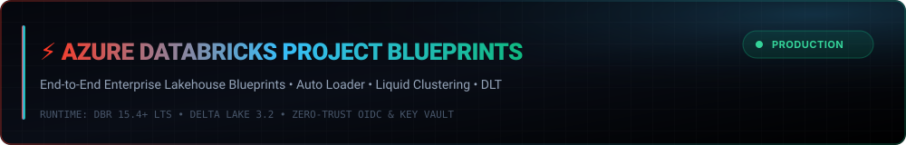
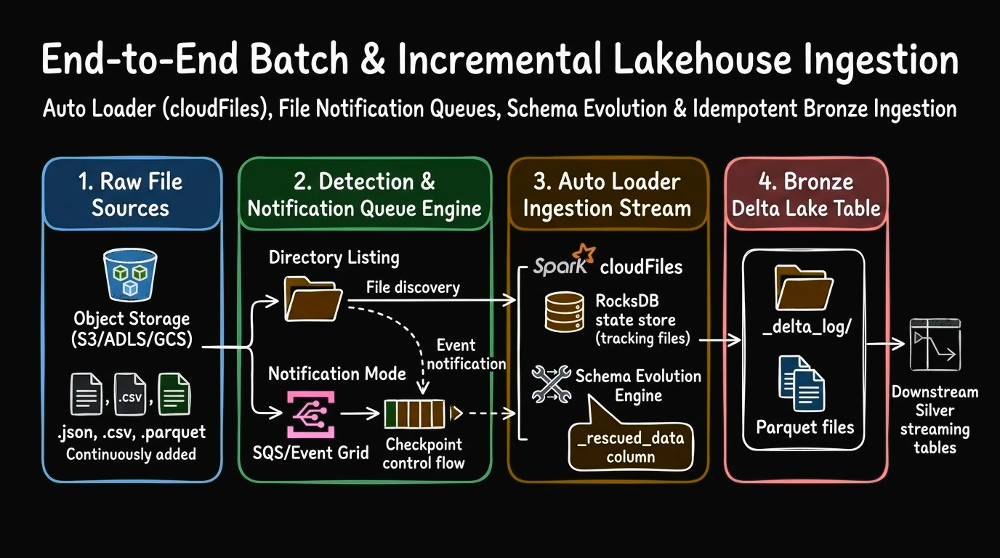
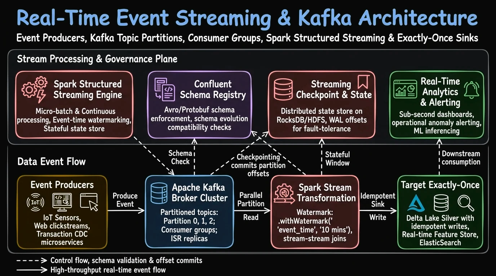

<p align="center">
  
</p>

# Azure Databricks Production Project Blueprints

<p align="center">
  <a href="https://github.com/santoshjammi29/azure-databricks-project-blueprints/actions"></a>
  <a href="https://databricks.com/"></a>
  <a href="https://www.python.org/"></a>
  <a href="LICENSE"></a>
  <a href="https://moderndataengineer.uk"></a>
</p>

## 🎯 Overview & Mission

Production-grade enterprise project implementations on **Azure Databricks**, **Delta Lake 3.x**, and **Unity Catalog**. This repository delivers end-to-end reference architectures, Databricks Asset Bundles (DABs) infrastructure-as-code, Delta Live Tables (DLT) declarative pipelines, and automated parity testing suites designed for Lead Data Engineers, Lakehouse Architects, and interview defense preparation.

---

## 🚀 Quickstart & DABs Validation

Validate and deploy the Databricks Asset Bundles locally or against your Azure Databricks workspace:

```bash
# 1. Clone the repository
git clone https://github.com/santoshjammi29/azure-databricks-project-blueprints.git
cd azure-databricks-project-blueprints

# 2. Validate Databricks Asset Bundle (IaC)
databricks bundle validate -t dev

# 3. Set up virtual environment and install test dependencies
python3 -m venv .venv
source .venv/bin/activate
pip install -r requirements.txt

# 4. Execute automated test suite (Ruff linter & pytest)
pytest tests/
```

---

## 🏛️ Master Enterprise Project Index & Blueprints

### 1. Omnichannel Retail Sales & Inventory Lakehouse
- **Pattern**: Metadata-driven ingestion, Auto Loader schema evolution, Lakeflow Declarative Pipelines.
- **Key Techniques**:
  - Grain modeling: Order line item fact (`fact_sales_line`) and daily stock snapshot (`fact_inventory_daily`).
  - Liquid Clustering (`CLUSTER BY`) and Deletion Vectors (Merge-on-Read).
  - Out-of-order CDC processing into SCD Type 2 dimensions via `APPLY CHANGES INTO`.
  - Databricks SQL Serverless and Power BI Direct Lake delivery.

### 2. Real-Time Payments Fraud & AML Monitoring
- **Pattern**: Continuous streaming over Azure Event Hubs with low-latency alert generation.
- **Key Techniques**:
  - Structured Streaming with off-heap RocksDB state store provider.
  - Event-time watermarking bounding 15-minute and 1-hour sliding velocity windows.
  - Idempotent alert egress resolving dual-sink non-transactional delivery.
  - Unity Catalog dynamic column masking for PCI-DSS compliance.

### 3. Legacy Warehouse Modernization & Controlled Cutover
- **Pattern**: Phased migration from legacy SQL warehouse to governed Lakehouse.
- **Key Techniques**:
  - Dependency-graph phased migration across 4 topological waves.
  - Automated dual-run parity verification engine checking row counts, hash sums, and variance.
  - Declarative Automation Bundles (DABs) for GitOps and multi-target deployments.
  - Delta Time Travel rollback and recovery runbooks.

---

---

---

## 🖼️ Master Whiteboard Architecture Blueprints

The repository incorporates publication-grade architectural whiteboard blueprints mirrored under [`assets/whiteboards/`](assets/whiteboards) and indexed with comprehensive multi-persona breakdowns, failure modes, and engine internals in [`docs/whiteboard_diagrams/README.md`](docs/whiteboard_diagrams/README.md).

- 🖼️ **[Master Whiteboard Blueprints Hub](docs/whiteboard_diagrams/handbook_whiteboard_blueprints.md)**: Complete whiteboard architecture blueprints with storage vs. compute, control vs. data planes, memory tiers, and failure modes.
- 📊 **[Spark Architecture & Tuning Cheatsheet](assets/whiteboards/catalyst_photon_engine.webp)**: High-resolution visual cheatsheet covering cluster topology, Catalyst compiler phases, and memory tiers.
- 🔀 **[Join Strategies Decision Matrix](assets/whiteboards/spark_join_decision_tree.webp)**: Visual flowchart and decision tree for distributed joins and broadcast thresholds.
- ⚡ **[Skew & Memory Spill Triage](assets/whiteboards/spark_memory_management_spill_diagram.webp)**: Step-by-step diagnostic workflow for data skew, spill to disk, and OOM triage.

### 📐 Visual Blueprints Showcase (2x2 Grid)

<table>
  <tr>
    <td width="50%" valign="top">
      <a href="docs/whiteboard_diagrams/README.md#databricks-medallion-pipeline">
        
      </a>
      <br><strong>Databricks Medallion Lakehouse Architecture</strong><br>
      <em>Core architecture for Project 01: Bronze raw landing, Silver conformed cleaning, and Gold analytics delivery.</em>
    </td>
    <td width="50%" valign="top">
      <a href="docs/whiteboard_diagrams/README.md#lakehouse-ingestion-autoloader">
        
      </a>
      <br><strong>End-to-End Batch & Incremental Lakehouse Ingestion</strong><br>
      <em>Auto Loader file notification, schema evolution, and streaming micro-batch ingestion from ADLS Gen2.</em>
    </td>
  </tr>
  <tr>
    <td width="50%" valign="top">
      <a href="docs/whiteboard_diagrams/README.md#kafka-event-streaming-pipeline">
        
      </a>
      <br><strong>Real-Time Event Streaming & Kafka Architecture</strong><br>
      <em>Core pipeline for Project 02: Azure Event Hubs ingestion, consumer group rebalancing, and low-latency processing.</em>
    </td>
    <td width="50%" valign="top">
      <a href="docs/whiteboard_diagrams/README.md#streaming-dlq-recovery-flow">
        
      </a>
      <br><strong>Stateful Streaming Failure Recovery & DLQ Remediation</strong><br>
      <em>Poison pill message quarantine, exponential backoff retries, and automated transaction recovery.</em>
    </td>
  </tr>
  <tr>
    <td width="50%" valign="top">
      <a href="docs/whiteboard_diagrams/README.md#delta-live-tables-pipeline">
        
      </a>
      <br><strong>Delta Live Tables (DLT) Declarative Pipeline</strong><br>
      <em>Declarative ETL DAG, Streaming Tables vs Materialized Views, and automated data quality expectations.</em>
    </td>
    <td width="50%" valign="top">
      <a href="docs/whiteboard_diagrams/README.md#databricks-dabs-devops-pipeline">
        
      </a>
      <br><strong>Databricks Asset Bundles (DABs) & Serverless CI/CD Architecture</strong><br>
      <em>Core DevOps for Project 03: GitOps release automation, bundle validation, and multi-target deployments.</em>
    </td>
  </tr>
  <tr>
    <td width="50%" valign="top">
      <a href="docs/whiteboard_diagrams/README.md#lakehouse-acid-concurrency">
        
      </a>
      <br><strong>Lakehouse ACID Concurrency & Write Conflict Resolution Matrix</strong><br>
      <em>Optimistic Concurrency Control (OCC), commit collision triage, and idempotent MERGE INTO patterns.</em>
    </td>
    <td width="50%" valign="top">
      <a href="docs/whiteboard_diagrams/README.md#lakehouse-access-masking-lifecycle">
        
      </a>
      <br><strong>Lakehouse Fine-Grained Access Control & Dynamic Masking</strong><br>
      <em>Unity Catalog SQL UDF masking and row filters protecting sensitive PCI-DSS cardholder payment data.</em>
    </td>
  </tr>
</table>

> 🔍 **Explore all 52 blueprints with 5-persona breakdowns, failure modes, and engine internals in [docs/whiteboard_diagrams/README.md](docs/whiteboard_diagrams/README.md)**.

---

## 🛠️ Repository Directory Structure
```text
├── databricks.yml              # Declarative Automation Bundles root definition
├── docs/                       # Architectural specifications and interview defense guides
├── resources/                  # Lakeflow workflow resource definitions
├── src/                        # PySpark pipelines, SQL DDL, and UDFs
└── tests/                      # Automated unit tests with Pytest
```

## 🧠 Core Curriculum Concepts & Topics (208 Topics Covered)

> 💡 **Enterprise Knowledge Base Integration**: This repository implements **208 production topics** from the [Modern Data Engineering Systems Encyclopedia (921 Topics)](https://moderndataengineer.uk/concepts), grouped by **Relevant Functional Sections** and then by **Difficulty Level**. All sections are **collapsible and collapsed by default** for effortless navigation. Browse the full curriculum in [`topics/README.md`](topics/README.md).

### 📑 Topics Directory at a Glance

| Pillar / Module | Topic Count | Functional Sections Covered | Status |
|:---|:---:|:---|:---:|
| ⚡ **Databricks Platform, Unity Catalog & Delta Lake 3.x** | **132** | Unity Catalog 3-Tier Governance & Security, Workspace, Serverless Compute & FinOps, Workflows, DLT & Lakeflow Pipelines, and 2 more | ✅ Collapsible Deck |
| 🌊 **Real-Time Streaming Lakehouse, CDC & Table Formats** | **76** | Distributed State, CDC & Lakehouse Ingestion, Engine Vectorization & Hardware Acceleration, Open Table Formats (Iceberg, Delta, Hudi), and 1 more | ✅ Collapsible Deck |

<details>
<summary><b>⚡ Databricks Platform, Unity Catalog & Delta Lake 3.x (132 Topics across 5 Sections)</b> — <i>Click to expand module</i></summary>

<details>
<summary>&nbsp;&nbsp;📂 <b>Section: Unity Catalog 3-Tier Governance & Security (42 Topics)</b></summary>

<details>
<summary>&nbsp;&nbsp;&nbsp;&nbsp;🟢 Easy: <b>🟢 Easy (Level 1) (7 Topics)</b></summary>

| # | Topic / Concept | Level | Architectural Definition & Core Principle |
|:---:|---|:---:|---|
| 1 | **Cluster Policy** | `🟢 Easy` | A Cluster Policy is an administrative governance rule set that restricts the configuration options available to users when provisioning compute clusters. |
| 2 | **Data Explorer** | `🟢 Easy` | Data Explorer is the visual UI tool in the Databricks Workspace used to discover, manage, inspect, and grant permissions on Unity Catalog data assets. |
| 3 | **Databricks Workspace** | `🟢 Easy` | A Databricks Workspace is a software-as-a-service (SaaS) environment that provides a unified collaborative interface for data engineers, data scientists, and analysts to access compute, notebooks, and storage. |
| 4 | **Metastore** | `🟢 Easy` | A Metastore is the central metadata repository that catalogs schema definitions, table partition locations, data types, and access privileges for data stored in the lakehouse. |
| 5 | **Three-Level Namespace** | `🟢 Easy` | The standard 3-tier logical namespace (`catalog.schema.table_or_view`) introduced by Unity Catalog to structure enterprise data assets, manage permissions, and enforce data mesh boundaries. |
| 6 | **Unity Catalog** | `🟢 Easy` | Unity Catalog is Databricks' centralized, multi-cloud governance solution providing unified access control, data auditing, lineage tracking, and discovery across all workspace assets. |
| 7 | **Volumes** | `🟢 Easy` | Governed Unity Catalog storage abstractions that provide secure access, governance, and audit lineage for non-tabular files including raw CSVs, unstructured text, images, and machine learning models. |

</details>

<details>
<summary>&nbsp;&nbsp;&nbsp;&nbsp;🟡 Intermediate: <b>🟡 Intermediate (Level 2) (11 Topics)</b></summary>

| # | Topic / Concept | Level | Architectural Definition & Core Principle |
|:---:|---|:---:|---|
| 1 | **Compute Policies & Cluster Governance** | `🟡 Intermediate` | Administrative governance guardrails that enforce compute provisioning boundaries—including allowed VM types, max worker limits, spot instance allocations, and idle auto-termination. |
| 2 | **Data Lineage** | `🟡 Intermediate` | The automated, real-time metadata tracking engine in Unity Catalog that captures column-level and table-level data flow lineage across queries, notebooks, workflows, and dashboards. |
| 3 | **Delta UniForm & Multi-Engine Interoperability** | `🟡 Intermediate` | Delta Lake Universal Format (UniForm), which automatically translates and maintains Apache Iceberg and Apache Hudi metadata alongside Delta logs, enabling multi-engine query access without data duplication. |
| 4 | **Dynamic Views for Security** | `🟡 Intermediate` | Security-hardened SQL views that evaluate user context functions (`CURRENT_USER()`, `IS_MEMBER()`) at runtime to provide row-level filtering and column-level masking without duplicating data. |
| 5 | **External Locations & Storage Credentials** | `🟡 Intermediate` | Unity Catalog securable objects that encapsulate cloud identity credentials (IAM roles, Managed Identities) and associate them with specific object storage URLs for governed external table access. |
| 6 | **Managed vs. External Tables: Architecture Tradeoffs** | `🟡 Intermediate` | The strategic trade-offs between Unity Catalog managed tables (lifecycle managed by Databricks, Predictive Optimization enabled) and external tables (custom storage locations, multi-engine access). |
| 7 | **Permission Model & Inheritance** | `🟡 Intermediate` | The hierarchical access control model in Unity Catalog where security privileges granted on parent securable objects (Catalogs) automatically cascade down to Schemas, Tables, and Views. |
| 8 | **System Tables for Operations** | `🟡 Intermediate` | Centrally governed, audit-grade operational telemetry tables in Unity Catalog (`system.billing`, `system.compute`, `system.access`) used for cost tracking, cluster audit logs, and FinOps analytics. |
| 9 | **Unity Catalog Lineage Tracking** | `🟡 Intermediate` | Automated capture of column-level and table-level data flow across queries, jobs, and dashboards. |
| 10 | **Unity Catalog Volumes (Managed vs. External)** | `🟡 Intermediate` | A Unity Catalog securable object that extends centralized catalog governance, audit trails, and SQL permissions to unstructured and semi-structured files. |
| 11 | **Vector Search** | `🟡 Intermediate` | Databricks Vector Search is a serverless vector database integrated into Unity Catalog that stores and indexes vector embeddings for real-time similarity search and RAG applications. |

</details>

<details>
<summary>&nbsp;&nbsp;&nbsp;&nbsp;🔴 Advanced: <b>🔴 Advanced (Level 3) (9 Topics)</b></summary>

| # | Topic / Concept | Level | Architectural Definition & Core Principle |
|:---:|---|:---:|---|
| 1 | **Audit Logging** | `🔴 Advanced` | Audit Logging captures, records, and exports detailed security audit trails of all user and system activities occurring across Databricks workspaces and Unity Catalog. |
| 2 | **Databricks DBU Allocation via system.billing.usage** | `🔴 Advanced` | The system catalog telemetry table in Unity Catalog that records minute-by-minute Databricks Unit (DBU) consumption across all workspaces, jobs, and users. |
| 3 | **Lakehouse Federation** | `🔴 Advanced` | Lakehouse Federation allows Unity Catalog to query external operational and analytical databases (Snowflake, BigQuery, PostgreSQL, MySQL, SQL Server) in place without moving data. |
| 4 | **Multi-Workspace Architecture** | `🔴 Advanced` | Enterprise platform deployment topology evaluating single-workspace versus multi-workspace designs for team isolation, regulatory compliance boundaries, and multi-region governance. |
| 5 | **Predictive Optimization** | `🔴 Advanced` | Predictive Optimization is an automated AI-driven service in Databricks that intelligently schedules OPTIMIZE and VACUUM maintenance operations on Unity Catalog managed tables. |
| 6 | **Row Filters & Column Masks** | `🔴 Advanced` | Applying row-level and column-level security directly to tables via SQL UDFs. |
| 7 | **SCIM Provisioning** | `🔴 Advanced` | SCIM (System for Cross-domain Identity Management) Provisioning automatically synchronizes users, service principals, and security groups from enterprise identity providers to Databricks. |
| 8 | **Unity Catalog Fine-Grained Access Control** | `🔴 Advanced` | Fine-Grained Access Control in Unity Catalog enforces cell-level security via Row Filters and Column Masks defined with standard SQL functions. |
| 9 | **Unity Catalog System Tables** | `🔴 Advanced` | Unity Catalog System Tables are analytical Delta tables hosted in the system catalog that expose operational metadata, cost telemetry, query history, and data lineage. |

</details>

<details>
<summary>&nbsp;&nbsp;&nbsp;&nbsp;🟣 Architect: <b>🟣 Staff Architect (Level 4) (15 Topics)</b></summary>

| # | Topic / Concept | Level | Architectural Definition & Core Principle |
|:---:|---|:---:|---|
| 1 | **Data Mesh on Databricks** | `🟣 Architect` | An architectural implementation of the Data Mesh paradigm on Databricks, treating data as a product owned by decentralized domain teams governed by Unity Catalog. |
| 2 | **Databricks + dbt Integration** | `🟣 Architect` | The production architecture pairing dbt with Databricks SQL Serverless and Unity Catalog, leveraging the dbt-databricks adapter for high-performance lakehouse transformations. |
| 3 | **Databricks Genie Compound AI** | `🟣 Architect` | A natural language conversational interface translating business questions into certified SQL over Unity Catalog metric views. |
| 4 | **Databricks Lakeflow Connectors** | `🟣 Architect` | Native managed SaaS and database ingestion connectors for Salesforce, Workday, ServiceNow, and SQL databases into Unity Catalog. |
| 5 | **Databricks Split-Plane Cloud Architecture** | `🟣 Architect` | A dual-plane cloud security model that segregates management/control infrastructure from distributed compute execution and persistent customer storage. |
| 6 | **Databricks Unity Catalog Architecture** | `🟣 Architect` | The centralized governance, metadata, and fine-grained access control layer for all data and AI assets across multiple Databricks workspaces in a cloud tenant. |
| 7 | **DBU Cost Governance** | `🟣 Architect` | The architectural framework and operational policies used to monitor, allocate, forecast, and optimize Databricks Unit (DBU) consumption and cloud infrastructure costs. |
| 8 | **Governance with Unity Catalog + Purview** | `🟣 Architect` | The enterprise governance integration between Databricks Unity Catalog and Microsoft Purview, unifying lakehouse metadata with company-wide data governance. |
| 9 | **Mosaic AI Vector Search Continuous Delta Sync** | `🟣 Architect` | A serverless vector database integrated with Unity Catalog that automatically synchronizes vector embeddings with underlying Delta tables in real time. |
| 10 | **Multi-Cloud Databricks Deployment** | `🟣 Architect` | An enterprise deployment pattern operating Databricks across multiple cloud providers (AWS, Azure, GCP) while maintaining unified governance and consistent CI/CD pipelines. |
| 11 | **Unity Catalog Dynamic Column Masking & Row Filters** | `🟣 Architect` | Declarative SQL-based fine-grained access control policies enforced transparently at the Unity Catalog metadata layer. |
| 12 | **Unity Catalog Dynamic Row Filters & Column Masks** | `🟣 Architect` | Fine-grained SQL access control mechanisms in Unity Catalog that dynamically redact columns or filter table rows based on the querying user's group membership. |
| 13 | **Unity Catalog Enterprise Governance** | `🟣 Architect` | The enterprise governance operating model for Unity Catalog encompassing account-level identity management, catalog segregation, classification tagging, and regulatory audit compliance. |
| 14 | **Unity Catalog Multi-Workspace Topology** | `🟣 Architect` | An enterprise architecture design that connects multiple environment- or business-unit-specific workspaces to a single regional Unity Catalog metastore. |
| 15 | **Unity Catalog System Tables for Lakehouse FinOps** | `🟣 Architect` | Centrally governed, read-only analytical schemas providing real-time telemetry on compute usage, billing, audit access, and lineage across an entire account. |

</details>

</details>

<details>
<summary>&nbsp;&nbsp;📂 <b>Section: Delta Lake 3.x ACID Mechanics & Transaction Log (10 Topics)</b></summary>

<details>
<summary>&nbsp;&nbsp;&nbsp;&nbsp;🟢 Easy: <b>🟢 Easy (Level 1) (4 Topics)</b></summary>

| # | Topic / Concept | Level | Architectural Definition & Core Principle |
|:---:|---|:---:|---|
| 1 | **ACID Transactions** | `🟢 Easy` | The set of transactional guarantees (Atomicity, Consistency, Isolation, Durability) enforced by Delta Lake on top of cloud object storage using an append-only transaction log and optimistic concurrency control. |
| 2 | **Delta Lake (Databricks)** | `🟢 Easy` | Delta Lake is an open-source storage framework that brings ACID transactions, scalable metadata handling, and unified streaming and batch data processing to Apache Spark and data lakes. |
| 3 | **Shallow vs. Deep Clones** | `🟢 Easy` | Delta Lake table cloning capabilities that either create zero-copy metadata pointers to source data files (SHALLOW CLONE) or create fully independent physical table copies (DEEP CLONE). |
| 4 | **Transaction Log (`_delta_log`)** | `🟢 Easy` | The ordered, append-only directory of JSON commit files and Parquet checkpoints (`_delta_log`) that serves as the single source of truth for all metadata, schema versions, and physical file operations in a Delta table. |

</details>

<details>
<summary>&nbsp;&nbsp;&nbsp;&nbsp;🟡 Intermediate: <b>🟡 Intermediate (Level 2) (4 Topics)</b></summary>

| # | Topic / Concept | Level | Architectural Definition & Core Principle |
|:---:|---|:---:|---|
| 1 | **Databricks SQL Warehouse** | `🟡 Intermediate` | A Databricks SQL Warehouse is a specialized compute resource optimized for SQL workloads, business intelligence queries, and high-concurrency analytical dashboards. |
| 2 | **Delta Time Travel** | `🟡 Intermediate` | Delta Time Travel is the ability to query point-in-time historical snapshots of a Delta table using historical commit versions or timestamps. |
| 3 | **Shallow Clone vs Deep Clone** | `🟡 Intermediate` | Delta Cloning creates copies of a table: Shallow Clone copies only metadata references with zero data duplication, whereas Deep Clone creates a fully independent physical copy of data and metadata. |
| 4 | **VACUUM Command** | `🟡 Intermediate` | The VACUUM command permanently deletes historical data files from cloud storage that are no longer referenced by the active Delta table log and exceed a retention threshold. |

</details>

<details>
<summary>&nbsp;&nbsp;&nbsp;&nbsp;🔴 Advanced: <b>🔴 Advanced (Level 3) (1 Topics)</b></summary>

| # | Topic / Concept | Level | Architectural Definition & Core Principle |
|:---:|---|:---:|---|
| 1 | **Databricks Serverless SQL Warehouse** | `🔴 Advanced` | A fully managed, instant-starting compute tier in Databricks optimized for high-concurrency SQL and BI queries running inside Databricks-managed compute planes. |

</details>

<details>
<summary>&nbsp;&nbsp;&nbsp;&nbsp;🟣 Architect: <b>🟣 Staff Architect (Level 4) (1 Topics)</b></summary>

| # | Topic / Concept | Level | Architectural Definition & Core Principle |
|:---:|---|:---:|---|
| 1 | **Stream-to-Table Commit Boundary** | `🟣 Architect` | The consistency boundary between a streaming engine's checkpoint progress and the durable commit visible in its table sink. |

</details>

</details>

<details>
<summary>&nbsp;&nbsp;📂 <b>Section: Physical Layout, Liquid Clustering & Deletion Vectors (12 Topics)</b></summary>

<details>
<summary>&nbsp;&nbsp;&nbsp;&nbsp;🟢 Easy: <b>🟢 Easy (Level 1) (1 Topics)</b></summary>

| # | Topic / Concept | Level | Architectural Definition & Core Principle |
|:---:|---|:---:|---|
| 1 | **Delta Lake Liquid Clustering vs Hive Partitioning** | `🟢 Easy` | A physical data layout protocol that dynamically groups data along multiple columns without the rigidity, small-file explosion, or partition skew of traditional Hive directory trees. |

</details>

<details>
<summary>&nbsp;&nbsp;&nbsp;&nbsp;🟡 Intermediate: <b>🟡 Intermediate (Level 2) (6 Topics)</b></summary>

| # | Topic / Concept | Level | Architectural Definition & Core Principle |
|:---:|---|:---:|---|
| 1 | **Cluster Sizing & Autoscaling** | `🟡 Intermediate` | The operational strategy of balancing cluster node memory-to-core ratios and autoscaling worker limits to optimize workload parallelism while controlling cloud infrastructure spending. |
| 2 | **OPTIMIZE & File Compaction** | `🟡 Intermediate` | A Delta Lake table maintenance command that bin-packs small files (1MB–10MB) into optimal larger files (~1GB) to reduce cloud object storage API overhead and significantly accelerate analytical query scanning performance. |
| 3 | **OPTIMIZE Command** | `🟡 Intermediate` | The OPTIMIZE command compacts fragmented small Parquet files in a Delta table into larger, query-efficient files (typically ~1GB in size). |
| 4 | **VACUUM & Storage Lifecycle** | `🟡 Intermediate` | A Delta Lake table maintenance command that permanently purges unreferenced physical data files older than a configured retention safety threshold (default 7 days) to reclaim object storage capacity. |
| 5 | **Write Optimization** | `🟡 Intermediate` | Delta Lake write-time optimizations—such as `optimizeWrite` and auto-compaction—that dynamically coalesce and size Parquet data files during ingestion to avoid small-file fragmentation. |
| 6 | **Z-Ordering** | `🟡 Intermediate` | Z-Ordering is a multidimensional clustering technique that colocates related information in the same set of Parquet files to maximize file skipping during SQL queries. |

</details>

<details>
<summary>&nbsp;&nbsp;&nbsp;&nbsp;🔴 Advanced: <b>🔴 Advanced (Level 3) (3 Topics)</b></summary>

| # | Topic / Concept | Level | Architectural Definition & Core Principle |
|:---:|---|:---:|---|
| 1 | **Delta Table Properties & Configuration** | `🔴 Advanced` | Configurable table-level metadata properties in Delta Lake that govern engine behavior, including Change Data Feed enablement, Deletion Vector activation, column mapping mode, and checkpoint frequency. |
| 2 | **Liquid Clustering** | `🔴 Advanced` | Delta Lake 3.x's next-generation data layout engine (`CLUSTER BY`) that organizes data along space-filling curves to optimize multi-dimensional query pruning without hive partitioning or write amplification. |
| 3 | **MERGE Write Amplification** | `🔴 Advanced` | The storage I/O performance penalty in copy-on-write architectures where updating a single row forces the engine to rewrite the entire underlying Parquet file. |

</details>

<details>
<summary>&nbsp;&nbsp;&nbsp;&nbsp;🟣 Architect: <b>🟣 Staff Architect (Level 4) (2 Topics)</b></summary>

| # | Topic / Concept | Level | Architectural Definition & Core Principle |
|:---:|---|:---:|---|
| 1 | **Delta Lake Deletion Vectors** | `🟣 Architect` | A storage optimization technique in Delta Lake that marks deleted or updated rows using lightweight bitmap index files instead of rewriting entire Parquet data files. |
| 2 | **Delta Lake Liquid Clustering Architecture** | `🟣 Architect` | A modern, dynamic data layout architecture that organizes Delta Lake Parquet files along a space-filling Hilbert curve without rigid Hive directory hierarchies. |

</details>

</details>

<details>
<summary>&nbsp;&nbsp;📂 <b>Section: Workflows, DLT & Lakeflow Pipelines (18 Topics)</b></summary>

<details>
<summary>&nbsp;&nbsp;&nbsp;&nbsp;🟢 Easy: <b>🟢 Easy (Level 1) (4 Topics)</b></summary>

| # | Topic / Concept | Level | Architectural Definition & Core Principle |
|:---:|---|:---:|---|
| 1 | **Databricks Job** | `🟢 Easy` | A Databricks Job is a scheduled or triggered execution unit that runs non-interactive code (notebooks, JARs, Python scripts, dbt models) on automated compute clusters. |
| 2 | **Databricks Workflow** | `🟢 Easy` | Databricks Workflows is the fully managed, native orchestration service within Databricks that designs, schedules, and monitors multi-task Directed Acyclic Graphs (DAGs). |
| 3 | **Job Cluster** | `🟢 Easy` | A Job Cluster is an ephemeral, dedicated compute cluster automatically provisioned by Databricks to execute a specific automated workload and terminated immediately upon completion. |
| 4 | **Parameterization: Widgets, Job Parameters, Task Values** | `🟢 Easy` | The runtime parameterization suite in Databricks—including notebook widgets, job-level parameters, and inter-task dynamic task values—used to construct dynamic and reusable workflows. |

</details>

<details>
<summary>&nbsp;&nbsp;&nbsp;&nbsp;🟡 Intermediate: <b>🟡 Intermediate (Level 2) (6 Topics)</b></summary>

| # | Topic / Concept | Level | Architectural Definition & Core Principle |
|:---:|---|:---:|---|
| 1 | **DBU Cost Model & Billing** | `🟡 Intermediate` | The consumption-based billing framework where platform workloads consume Databricks Units (DBUs) based on compute SKU tiers (All-Purpose, Automated Jobs, SQL Serverless, and Lakeflow). |
| 2 | **Delta Live Tables (DLT)** | `🟡 Intermediate` | Delta Live Tables (DLT) is a declarative ETL framework in Databricks that simplifies data pipeline development by managing dependencies, infrastructure scaling, and data quality enforcement. |
| 3 | **Expectations (Quality Rules)** | `🟡 Intermediate` | Declarative data quality rules in Lakeflow pipelines (`EXPECT`, `EXPECT OR DROP`, `EXPECT OR FAIL`) that audit record integrity and maintain automated telemetry on data quality metrics. |
| 4 | **Incremental Processing Patterns** | `🟡 Intermediate` | Data pipeline design architectures that ingest and transform only new or modified data since the prior execution checkpoint, leveraging Auto Loader, Change Data Feed, and streaming watermarks. |
| 5 | **Streaming Tables vs. Materialized Views** | `🟡 Intermediate` | The architectural distinction in Lakeflow between append-only Streaming Tables for continuous incremental ingestion and stateful Materialized Views for precomputed analytical query acceleration. |
| 6 | **Task Dependencies, Retries & Conditional Logic** | `🟡 Intermediate` | Workflow orchestration primitives in Lakeflow Jobs that define multi-task DAG dependencies, conditional branch routing, retry policies, and SLA timeout limits. |

</details>

<details>
<summary>&nbsp;&nbsp;&nbsp;&nbsp;🔴 Advanced: <b>🔴 Advanced (Level 3) (7 Topics)</b></summary>

| # | Topic / Concept | Level | Architectural Definition & Core Principle |
|:---:|---|:---:|---|
| 1 | **CDC Processing: AUTO CDC INTO** | `🔴 Advanced` | Declarative CDC processing primitives in Lakeflow pipelines that automatically reconcile out-of-order change logs and maintain SCD Type 1 or SCD Type 2 dimension tables. |
| 2 | **Databricks Delta Live Tables (DLT) Expectations** | `🔴 Advanced` | Declarative data quality rules (`@dlt.expect`, `@dlt.expect_or_drop`, `@dlt.expect_or_fail`) embedded into streaming pipelines. |
| 3 | **DLT Expectations** | `🔴 Advanced` | DLT Expectations are declarative data quality assertions applied to Delta Live Tables that validate incoming records and govern pipeline behavior upon data quality violations. |
| 4 | **Error Handling & Dead Letter Patterns** | `🔴 Advanced` | A resilient pipeline design pattern that routes malformed or schema-violating records into quarantined Dead-Letter Queue (DLQ) tables for offline inspection without aborting the pipeline. |
| 5 | **Join Performance Diagnosis** | `🔴 Advanced` | When a join is the bottleneck: reading shuffle sizes, spill metrics, and task skew in Spark UI for join stages. |
| 6 | **Performance Troubleshooting Methodology** | `🔴 Advanced` | A structured diagnostic workflow for identifying lakehouse performance bottlenecks by analyzing Spark UI stages, query execution plans, shuffle spill, data skew, and cluster resource utilization. |
| 7 | **Serverless DLT** | `🔴 Advanced` | Serverless DLT executes Delta Live Tables pipelines on instant, fully managed serverless compute clusters operated within the Databricks cloud control plane. |

</details>

<details>
<summary>&nbsp;&nbsp;&nbsp;&nbsp;🟣 Architect: <b>🟣 Staff Architect (Level 4) (1 Topics)</b></summary>

| # | Topic / Concept | Level | Architectural Definition & Core Principle |
|:---:|---|:---:|---|
| 1 | **Lakeflow Spark Declarative Pipelines (DLT)** | `🟣 Architect` | A declarative framework for building, testing, and operating reliable lakehouse ETL pipelines with managed orchestration, state, and data quality expectations. |

</details>

</details>

<details>
<summary>&nbsp;&nbsp;📂 <b>Section: Workspace, Serverless Compute & FinOps (50 Topics)</b></summary>

<details>
<summary>&nbsp;&nbsp;&nbsp;&nbsp;🟢 Easy: <b>🟢 Easy (Level 1) (10 Topics)</b></summary>

| # | Topic / Concept | Level | Architectural Definition & Core Principle |
|:---:|---|:---:|---|
| 1 | **All-Purpose Cluster** | `🟢 Easy` | An All-Purpose Cluster is a shared interactive compute cluster designed for collaborative exploratory data analysis, interactive notebook development, and ad-hoc querying. |
| 2 | **Choosing Compute for Jobs** | `🟢 Easy` | The architectural decision framework for matching workloads to compute tiers: Serverless (zero startup delay, auto-managed), Classic Automated Jobs clusters (custom libraries), or All-Purpose clusters. |
| 3 | **Databricks Notebook** | `🟢 Easy` | A Databricks Notebook is a web-based interactive development document combining live executable code cells, interactive visualizations, and narrative markdown documentation. |
| 4 | **Databricks Repos** | `🟢 Easy` | Databricks Repos (now known as Git Folders) provides visual and programmatic Git version control integration directly inside the Databricks Workspace. |
| 5 | **DBFS (Databricks File System)** | `🟢 Easy` | DBFS (Databricks File System) is a distributed file system abstraction layer mounted over cloud object storage (S3 bucket, Azure container, GCS bucket) accessible across the workspace. |
| 6 | **dbutils** | `🟢 Easy` | Databricks Utilities (dbutils) is a built-in Python and Scala library that provides programmatic helper methods for file system operations, secret management, notebook workflows, and UI widgets. |
| 7 | **Magic Commands** | `🟢 Easy` | Magic Commands are special prefix directives (%python, %sql, %scala, %r, %sh, %fs) entered at the beginning of a notebook cell to alter the execution runtime or execute system utilities. |
| 8 | **Notebook Development Patterns** | `🟢 Easy` | Software engineering methodologies for Databricks notebooks, contrasting modular Python packages, Git Folders, and Databricks Connect against legacy `%run` script chaining. |
| 9 | **Secrets Management** | `🟢 Easy` | The secure credential management framework in Databricks (Secret Scopes backed by Azure Key Vault or encrypted storage) used to securely inject tokens, API keys, and connection strings at runtime. |
| 10 | **Serverless Compute Economics** | `🟢 Easy` | The FinOps cost and operational efficiency model of Databricks Serverless Compute, which eliminates idle capacity costs and cold-start latency through instant provisioning and per-workload DBU billing. |

</details>

<details>
<summary>&nbsp;&nbsp;&nbsp;&nbsp;🟡 Intermediate: <b>🟡 Intermediate (Level 2) (16 Topics)</b></summary>

| # | Topic / Concept | Level | Architectural Definition & Core Principle |
|:---:|---|:---:|---|
| 1 | **AI Functions for Data Engineers** | `🟡 Intermediate` | Built-in SQL functions (`ai_query()`, `ai_classify()`, `ai_extract()`) in Databricks SQL that invoke foundation LLMs directly within batch and streaming queries for automated data enrichment. |
| 2 | **Auto Loader** | `🟡 Intermediate` | Auto Loader is an optimized ingestion engine in Databricks that incrementally and efficiently ingests raw data files from cloud storage as they arrive without state tracking overhead. |
| 3 | **Change Data Feed (CDF)** | `🟡 Intermediate` | Change Data Feed (CDF) is a Delta Lake feature that captures and exposes row-level change events (inserts, updates, deletes) committed to a Delta table. |
| 4 | **Column Statistics & File Pruning** | `🟡 Intermediate` | Per-file min/max statistics collected for the first 32 columns by default (managed tables with Predictive Optimization choose columns intelligently). |
| 5 | **Databricks Feature Store** | `🟡 Intermediate` | The Databricks Feature Store is a centralized catalog that enables data scientists to discover, share, and reuse ML features with guaranteed online/offline consistency. |
| 6 | **Databricks Secret Scopes (Azure Key Vault)** | `🟡 Intermediate` | Secure credential storage backed by cloud key vaults, accessed in notebooks via `dbutils.secrets.get()`. |
| 7 | **Databricks Workspace File Sync (Repos)** | `🟡 Intermediate` | Bi-directional Git integration synchronizing branch code directly into Databricks workspace directories. |
| 8 | **Information Schema & Metadata Queries** | `🟡 Intermediate` | Querying `system.information_schema.tables`, `.columns`, `.table_privileges` to discover and audit catalog contents. |
| 9 | **Medallion Architecture on Databricks** | `🟡 Intermediate` | The Medallion Architecture is a lakehouse data design pattern that logically organizes data into Bronze (raw ingestion), Silver (cleaned/conformed), and Gold (curated business marts) quality layers. |
| 10 | **MLflow Model Registry** | `🟡 Intermediate` | The MLflow Model Registry provides a centralized model store, set of APIs, and UI to collaboratively manage the full lifecycle of MLflow models from development to production deployment. |
| 11 | **MLflow Tracking** | `🟡 Intermediate` | MLflow Tracking is an enterprise logging API and UI for recording machine learning experiment runs, hyperparameters, evaluation metrics, code versions, and serialized model artifacts. |
| 12 | **Monitoring, Alerting & SQL Alerts** | `🟡 Intermediate` | Automated operational monitoring and alert mechanisms in Databricks SQL that periodically evaluate query thresholds and dispatch notifications via Slack, PagerDuty, or Webhooks. |
| 13 | **Photon Engine** | `🟡 Intermediate` | Databricks' native, high-performance vectorized query execution engine written in C++ that leverages hardware SIMD acceleration and CPU cache locality to dramatically accelerate SQL and DataFrame workloads. |
| 14 | **Query Profile & Execution Plans** | `🟡 Intermediate` | Reading the DBSQL Query Profile (visual plan, statistics, bottleneck identification). |
| 15 | **Serverless vs Provisioned Auto-scaling Compute Economics** | `🟡 Intermediate` | The unit cost and utilization modeling comparing pay-per-second serverless execution runtimes against fixed, provisioned auto-scaling VM cluster pools. |
| 16 | **Service Principals & Managed Identity** | `🟡 Intermediate` | Using service principals for automated jobs instead of personal credentials. |

</details>

<details>
<summary>&nbsp;&nbsp;&nbsp;&nbsp;🔴 Advanced: <b>🔴 Advanced (Level 3) (11 Topics)</b></summary>

| # | Topic / Concept | Level | Architectural Definition & Core Principle |
|:---:|---|:---:|---|
| 1 | **Databricks Asset Bundles (DABs)** | `🔴 Advanced` | Databricks Asset Bundles (DABs) is an Infrastructure-as-Code (IaC) framework that allows developers to define, test, and deploy entire Databricks projects using version-controlled YAML configurations. |
| 2 | **Databricks Asset Bundles Multi-Environment Promotion** | `🔴 Advanced` | A declarative Infrastructure-as-Code (IaC) packaging framework that defines jobs, pipelines, notebooks, and permissions as versioned YAML for automated CI/CD promotion. |
| 3 | **Databricks Auto Loader (cloudFiles)** | `🔴 Advanced` | An optimized streaming source format in Databricks (`cloudFiles`) that incrementally and efficiently processes billions of new data files arriving in cloud storage without state file explosion. |
| 4 | **Databricks Connect v2** | `🔴 Advanced` | Databricks Connect v2 is a client library built on Spark Connect that allows developers to run PySpark code from local IDEs directly against remote Databricks compute clusters. |
| 5 | **Databricks Genie Spaces (Lakehouse AI)** | `🔴 Advanced` | An AI-powered conversational interface in Databricks that allows non-technical business stakeholders to query Lakehouse Delta tables using natural language. |
| 6 | **Databricks Structured Streaming** | `🔴 Advanced` | Databricks Structured Streaming is a scalable stream processing engine built on Spark SQL that processes continuous data streams with micro-batch or continuous processing semantics. |
| 7 | **Delta Lake Schema Enforcement vs. Evolution** | `🔴 Advanced` | Schema Enforcement prevents data corruption by blocking appends that deviate from table schema, while Schema Evolution allows controlled addition of new columns during write operations. |
| 8 | **Delta Sharing** | `🔴 Advanced` | Delta Sharing is an open, cross-platform protocol for securely sharing live data tables, schemas, and AI models across organizations and clouds without data duplication. |
| 9 | **SCD Type 1 & Type 2 Patterns** | `🔴 Advanced` | Dimensional modeling techniques in Delta Lake that either overwrite current dimension attribute values (SCD Type 1) or preserve historical state transitions using effective date ranges and active flags (SCD Type 2). |
| 10 | **Serverless Compute (Databricks)** | `🔴 Advanced` | Serverless Compute is an on-demand, fully managed compute architecture in Databricks that boots clusters in seconds and scales resources instantaneously within Databricks-managed cloud accounts. |
| 11 | **Spark Connect** | `🔴 Advanced` | Spark Connect is a decoupled client-server architecture for Apache Spark that enables thin clients and IDEs to execute Spark DataFrame queries via a lightweight gRPC protocol. |

</details>

<details>
<summary>&nbsp;&nbsp;&nbsp;&nbsp;🟣 Architect: <b>🟣 Staff Architect (Level 4) (13 Topics)</b></summary>

| # | Topic / Concept | Level | Architectural Definition & Core Principle |
|:---:|---|:---:|---|
| 1 | **CI/CD for Databricks with DABs** | `🟣 Architect` | The continuous integration and continuous deployment (CI/CD) architecture for Databricks using Databricks Asset Bundles (DABs) and Git automation pipelines. |
| 2 | **Databricks Asset Bundles (DABs) Infrastructure-as-Code** | `🟣 Architect` | A declarative Infrastructure-as-Code (IaC) standard for authoring, testing, deploying, and version-controlling Databricks data and AI projects. |
| 3 | **Databricks Asset Bundles (DABs) Multi-Target CI/CD** | `🟣 Architect` | The official Infrastructure-as-Code (IaC) standard for authoring, version-controlling, testing, and deploying Databricks Lakehouse workflows and pipelines across environments. |
| 4 | **Databricks Clean Rooms** | `🟣 Architect` | A secure multi-party collaboration environment allowing organizations to query shared datasets without exposing raw data. |
| 5 | **Databricks for Data Products** | `🟣 Architect` | The methodology and platform architecture for engineering, publishing, documenting, and monetizing curated data products on Databricks. |
| 6 | **Databricks Lakehouse vs Snowflake** | `🟣 Architect` | The enterprise architectural evaluation comparing Databricks' open, compute-flexible lakehouse platform against Snowflake's proprietary, SQL-centric cloud data warehouse platform. |
| 7 | **Databricks MLOps Platform** | `🟣 Architect` | An end-to-end Machine Learning Operations (MLOps) architecture on Databricks encompassing automated feature engineering, experiment tracking, model registry, and serverless model serving. |
| 8 | **Databricks Serverless Compute Architecture** | `🟣 Architect` | A cloud compute model where Databricks manages an instant warm pool of virtual machines in the Databricks compute plane, eliminating cluster startup latency. |
| 9 | **Databricks Serverless Compute Plane** | `🟣 Architect` | A fully managed, instant-start compute tier running inside Databricks-managed cloud subscriptions with pre-warmed container fleets and sub-second elasticity. |
| 10 | **Databricks Workflows vs Airflow** | `🟣 Architect` | The architectural decision framework comparing native Databricks Workflows with external general-purpose orchestrators like Apache Airflow. |
| 11 | **Disaster Recovery for Databricks** | `🟣 Architect` | The disaster recovery (DR) architecture for Databricks ensuring business continuity, minimal RPO, and near-zero RTO during regional cloud infrastructure outages. |
| 12 | **Petabyte-Scale ELT on Databricks** | `🟣 Architect` | The architectural principles and tuning strategies required to ingest, transform, and merge petabyte-scale data volumes on Databricks with predictable SLAs. |
| 13 | **Real-Time Lakehouse Architecture** | `🟣 Architect` | A unified lakehouse architecture that processes high-frequency real-time event streams (Kafka, Event Hubs) with sub-second to minute-level latency directly into Delta Lake. |

</details>

</details>

</details>

<details>
<summary><b>🌊 Real-Time Streaming Lakehouse, CDC & Table Formats (76 Topics across 4 Sections)</b> — <i>Click to expand module</i></summary>

<details>
<summary>&nbsp;&nbsp;📂 <b>Section: Open Table Formats (Iceberg, Delta, Hudi) (22 Topics)</b></summary>

<details>
<summary>&nbsp;&nbsp;&nbsp;&nbsp;🟢 Easy: <b>🟢 Easy (Level 1) (1 Topics)</b></summary>

| # | Topic / Concept | Level | Architectural Definition & Core Principle |
|:---:|---|:---:|---|
| 1 | **Apache Iceberg Hidden Partitioning & Manifest List Architecture** | `🟢 Easy` | Decouples table partitioning from physical directory structures, avoiding Hive-style column path rewrites. |

</details>

<details>
<summary>&nbsp;&nbsp;&nbsp;&nbsp;🟡 Intermediate: <b>🟡 Intermediate (Level 2) (4 Topics)</b></summary>

| # | Topic / Concept | Level | Architectural Definition & Core Principle |
|:---:|---|:---:|---|
| 1 | **Apache Hudi Copy-On-Write (COW)** | `🟡 Intermediate` | A table type that rewrites entire Parquet data files upon receiving row updates, maximizing subsequent read scan speeds. |
| 2 | **Delta Lake Column Mapping** | `🟡 Intermediate` | A Delta Lake metadata feature that decouples logical column names exposed to users from physical column identifiers stored inside Parquet files. |
| 3 | **Delta Lake Deletion Vectors (DV) vs Copy-on-Write (CoW)** | `🟡 Intermediate` | Soft-delete bitmap index avoiding full Parquet file rewrites on UPDATE and DELETE operations. |
| 4 | **Delta Standalone Reader & Writer** | `🟡 Intermediate` | A lightweight JVM library that allows reading and writing Delta Lake tables directly without requiring an active Apache Spark cluster or runtime. |

</details>

<details>
<summary>&nbsp;&nbsp;&nbsp;&nbsp;🔴 Advanced: <b>🔴 Advanced (Level 3) (6 Topics)</b></summary>

| # | Topic / Concept | Level | Architectural Definition & Core Principle |
|:---:|---|:---:|---|
| 1 | **Apache Hudi Merge-On-Read (MOR)** | `🔴 Advanced` | A table type storing real-time updates in compact columnar log files, merging with base Parquet files during query execution. |
| 2 | **Apache Iceberg Partition Evolution** | `🔴 Advanced` | A table format capability that updates partitioning schemas (e.g. from month to day) without rewriting historical data or invalidating existing queries. |
| 3 | **Copy-on-Write vs Merge-on-Read Table Format Trade-offs** | `🔴 Advanced` | The fundamental write-latency versus read-amplification trade-off between rewriting entire data files on mutation versus appending delta deletion files. |
| 4 | **Delta Lake Soft Deletion Vectors** | `🔴 Advanced` | Binary vector files recording deleted row positions, decoupling mutations from 500MB Parquet rewrites. |
| 5 | **Iceberg Equality Deletes vs. Position Deletes** | `🔴 Advanced` | The two deletion vector mechanisms supported by Apache Iceberg v2 to handle row-level deletions and updates without full data file rewrites. |
| 6 | **Iceberg Snapshot Expiration** | `🔴 Advanced` | Purging historical Iceberg table metadata and unreferenced Parquet data files to reclaim cloud storage and bound manifest list scan latency. |

</details>

<details>
<summary>&nbsp;&nbsp;&nbsp;&nbsp;🟣 Architect: <b>🟣 Staff Architect (Level 4) (11 Topics)</b></summary>

| # | Topic / Concept | Level | Architectural Definition & Core Principle |
|:---:|---|:---:|---|
| 1 | **Apache Iceberg REST Catalog Open Specification** | `🟣 Architect` | A vendor-neutral OpenAPI protocol that standardizes how query engines discover namespaces, load table metadata pointers, and perform atomic multi-table commit transactions. |
| 2 | **Apache Iceberg REST Catalog Specification** | `🟣 Architect` | An open, vendor-neutral HTTP OpenAPI standard for metadata discovery, atomic commit coordination, and table credential vending across multi-engine lakehouses. |
| 3 | **Apache Polaris Catalog Federation** | `🟣 Architect` | An open-source centralized metadata catalog built on the Apache Iceberg REST specification, providing unified cross-cloud governance and multi-engine interoperability. |
| 4 | **Delta Lake Change Data Feed (CDC & table_changes TVF)** | `🟣 Architect` | A native Delta table capability that exposes row-level change events (inserts, update pre-images, update post-images, deletes) between table versions. |
| 5 | **Delta Lake Conflict Detection Matrix** | `🟣 Architect` | The formal concurrency matrix in Delta Lake defining which write operations (append, update, delete, compaction) can commit concurrently under WriteSerializable isolation. |
| 6 | **Delta Lake Deletion Vectors (Merge-on-Read)** | `🟣 Architect` | A storage optimization that shifts Delta Lake write operations from Copy-on-Write (CoW) to Merge-on-Read (MoR) using compact RoaringBitmap row tombstones. |
| 7 | **Delta Lake Liquid Clustering & Space-Filling Curves** | `🟣 Architect` | A dynamic layout optimization using Hilbert space-filling curves that replaces rigid Hive-style directory partitioning and manual Z-Ordering. |
| 8 | **Delta Lake UniForm (Universal Format)** | `🟣 Architect` | An open lakehouse capability that writes Delta Parquet data files once while generating Iceberg and Hudi metadata asynchronously for multi-engine zero-copy read interoperability. |
| 9 | **Lakehouse UniForm Hudi Interoperability** | `🟣 Architect` | Cross-engine interoperability standard converting Delta commit logs into Apache Hudi timeline commit files. |
| 10 | **Power BI Direct Lake Mode: In-Memory VertiPaq Paging** | `🟣 Architect` | Zero-copy semantic model serving directly from OneLake Delta Parquet without Import or DirectQuery latency. |
| 11 | **UniForm Iceberg Metadata Translator** | `🟣 Architect` | The background asynchronous daemon in Delta Lake that converts Delta action commits into Apache Iceberg metadata manifest trees. |

</details>

</details>

<details>
<summary>&nbsp;&nbsp;📂 <b>Section: Real-Time Streaming & Watermarking (3 Topics)</b></summary>

<details>
<summary>&nbsp;&nbsp;&nbsp;&nbsp;🔴 Advanced: <b>🔴 Advanced (Level 3) (2 Topics)</b></summary>

| # | Topic / Concept | Level | Architectural Definition & Core Principle |
|:---:|---|:---:|---|
| 1 | **Apache Paimon Streaming Lakehouse** | `🔴 Advanced` | A streaming lakehouse storage format developed for high-throughput changelog ingestion, sub-second real-time streaming updates, and primary-key upserts with Apache Flink. |
| 2 | **Structured Streaming Watermarking & Allowed Lateness** | `🔴 Advanced` | Threshold specifying how far event-time can lag behind maximum observed event-time before data is dropped. |

</details>

<details>
<summary>&nbsp;&nbsp;&nbsp;&nbsp;🟣 Architect: <b>🟣 Staff Architect (Level 4) (1 Topics)</b></summary>

| # | Topic / Concept | Level | Architectural Definition & Core Principle |
|:---:|---|:---:|---|
| 1 | **Debezium CDC & Analytical Stream Decoupling** | `🟣 Architect` | Debezium CDC is a distributed transaction log mining engine that captures row-level database changes in real time, streaming events into Kafka to decouple OLTP from analytical lakehouses. |

</details>

</details>

<details>
<summary>&nbsp;&nbsp;📂 <b>Section: Engine Vectorization & Hardware Acceleration (4 Topics)</b></summary>

<details>
<summary>&nbsp;&nbsp;&nbsp;&nbsp;🟢 Easy: <b>🟢 Easy (Level 1) (2 Topics)</b></summary>

| # | Topic / Concept | Level | Architectural Definition & Core Principle |
|:---:|---|:---:|---|
| 1 | **In-Process Analytics Revolution: DuckDB and Polars via Apache Arrow Zero-Copy** | `🟢 Easy` | Serverless local analytical engines sharing columnar memory without serialization or network hops. |
| 2 | **Parquet Vectorized Decoding & Predicate Pushdown** | `🟢 Easy` | SIMD-accelerated column decoding combined with metadata-driven row group skipping via min/max statistics. |

</details>

<details>
<summary>&nbsp;&nbsp;&nbsp;&nbsp;🟡 Intermediate: <b>🟡 Intermediate (Level 2) (1 Topics)</b></summary>

| # | Topic / Concept | Level | Architectural Definition & Core Principle |
|:---:|---|:---:|---|
| 1 | **Cross-Engine Data Manipulation (Rosetta Stone)** | `🟡 Intermediate` | The Cross-Engine Rosetta Stone is an architectural translation matrix mapping common data engineering operations across SQL, PySpark, Pandas, and Polars. |

</details>

<details>
<summary>&nbsp;&nbsp;&nbsp;&nbsp;🟣 Architect: <b>🟣 Staff Architect (Level 4) (1 Topics)</b></summary>

| # | Topic / Concept | Level | Architectural Definition & Core Principle |
|:---:|---|:---:|---|
| 1 | **Databricks Serverless Compute & Photon Vectorized C++ Engine** | `🟣 Architect` | Instant-on, fully managed C++ query engine separating cluster provisioning from SQL execution. |

</details>

</details>

<details>
<summary>&nbsp;&nbsp;📂 <b>Section: Distributed State, CDC & Lakehouse Ingestion (47 Topics)</b></summary>

<details>
<summary>&nbsp;&nbsp;&nbsp;&nbsp;🟡 Intermediate: <b>🟡 Intermediate (Level 2) (6 Topics)</b></summary>

| # | Topic / Concept | Level | Architectural Definition & Core Principle |
|:---:|---|:---:|---|
| 1 | **Apache Airflow 3.0 Asset-Driven Scheduling & Deferrable Operators** | `🟡 Intermediate` | Event-driven DAG execution triggered by dataset updates combined with async triggerer workers. |
| 2 | **Hybrid Search Retrieval over Lakehouse Tables** | `🟡 Intermediate` | An enterprise retrieval architecture that merges sparse keyword search (BM25) with dense vector embeddings to provide accurate, hallucination-resistant context for RAG agents. |
| 3 | **OpenLineage & Spark UI DAG Task Skew Diagnostics** | `🟡 Intermediate` | Open-source standard for runtime lineage collection paired with Spark UI partition duration metrics. |
| 4 | **Parquet ZSTD Level 7 Recompression** | `🟡 Intermediate` | A high-ratio columnar compression algorithm developed by Facebook, offering 35-40% smaller disk footprint than Snappy with virtually identical decompression speed. |
| 5 | **QUALIFY Clause Window Filtering** | `🟡 Intermediate` | The QUALIFY clause filters the results of window functions directly within a single SELECT statement without requiring nested subqueries or Common Table Expressions. |
| 6 | **Spark 4.0 AQE Dynamic Shuffle Coalescing & Skew Join Mitigation** | `🟡 Intermediate` | Runtime query plan adjustments based on actual shuffle statistics collected during stage execution. |

</details>

<details>
<summary>&nbsp;&nbsp;&nbsp;&nbsp;🔴 Advanced: <b>🔴 Advanced (Level 3) (9 Topics)</b></summary>

| # | Topic / Concept | Level | Architectural Definition & Core Principle |
|:---:|---|:---:|---|
| 1 | **AI Data Workload Unit Economics** | `🔴 Advanced` | The cost model for delivering one useful AI-enabled data task, including retrieval, query compute, model inference, storage, and human review. |
| 2 | **CAP & PACELC Theorem in Modern Data Stores** | `🔴 Advanced` | In a network partition (P), trade off Availability (A) vs Consistency (C). PACELC extends this: Else (E), trade off Latency (L) vs Consistency (C). |
| 3 | **Cosmos DB Request Units (RU/s) & Analytical Store (HTAP)** | `🔴 Advanced` | Hybrid Transactional/Analytical Processing isolating row-store OLTP from columnar analytical sync. |
| 4 | **Cross-Cloud Egress-Aware Data Placement** | `🔴 Advanced` | A placement decision that weighs compute location, data gravity, egress charges, latency, residency, and operational ownership across cloud boundaries. |
| 5 | **Databricks Asset Bundles (DABs) & Declarative DataOps Pipelines** | `🔴 Advanced` | Infrastructure-as-Code for lakehouses defining jobs, pipelines, and permissions in version-controlled YAML. |
| 6 | **Lakehouse Deletion Vectors for Right-to-be-Forgotten Compliance** | `🔴 Advanced` | The application of lightweight position deletion files to remove individual customer PII records from immutable Parquet tables in compliance with privacy regulations without rewriting historical files. |
| 7 | **Star Schema Many-to-Many Bridge Tables** | `🔴 Advanced` | A Bridge Table (junction table) is an intermediate modeling construct in a Kimball Star Schema that resolves many-to-many relationships between facts and dimensions without Cartesian fan-out. |
| 8 | **Unity Catalog 3-Level Namespace & Attribute-Based Access Control (ABAC)** | `🔴 Advanced` | Unified lakehouse governance with catalog.schema.table namespace and tag-based dynamic masking policies. |
| 9 | **Vector Indexing Architecture: HNSW vs IVF in Enterprise RAG** | `🔴 Advanced` | Trade-offs between graph-based Hierarchical Navigable Small World and inverted file cluster indexing. |

</details>

<details>
<summary>&nbsp;&nbsp;&nbsp;&nbsp;🟣 Architect: <b>🟣 Staff Architect (Level 4) (32 Topics)</b></summary>

| # | Topic / Concept | Level | Architectural Definition & Core Principle |
|:---:|---|:---:|---|
| 1 | **Architectural Decision Records (ADRs) for Data Platforms** | `🟣 Architect` | A lightweight, immutable document capturing significant technical architecture decisions, the historical context, explored alternatives, and accepted long-term trade-offs. |
| 2 | **Blameless Data Incident Postmortems & Cost of Downtime** | `🟣 Architect` | A structured, blameless retrospective methodology for analyzing production data outages, identifying systemic root causes, quantifying financial impact, and implementing permanent safeguards. |
| 3 | **Canary Data Pipeline Deployment & Abort Circuit** | `🟣 Architect` | A release strategy where new pipeline code or transformation logic processes a small fraction of live data or runs in parallel shadow mode before full production cutover. |
| 4 | **Clustered Columnstore Rowgroup Health** | `🟣 Architect` | Columnstore rowgroup health measures the size, compaction state, and row count of columnar rowgroups, where the optimal target is exactly 1,048,576 rows per compressed rowgroup. |
| 5 | **Column-Level Encryption & Tokenization (FPE)** | `🟣 Architect` | Cryptographic data protection mechanisms that encrypt or tokenize sensitive PII attributes while preserving original data formats and enabling analytical queries. |
| 6 | **Data Asset Sunsetting & Graveyard Archiving** | `🟣 Architect` | A formal decommission and archival lifecycle process that safely retires obsolete data assets, reclaims storage costs, and satisfies legal record retention compliance. |
| 7 | **Data Contract Specification & Drift Prevention** | `🟣 Architect` | An explicit, version-controlled agreement between data producers and consumers specifying schema definitions, business semantics, SLA guarantees, and change management protocols. |
| 8 | **Data FinOps Unit Economics & Workload Right-Sizing** | `🟣 Architect` | The practice of measuring and optimizing cloud data platform expenditures by attributing costs to granular business units, product features, and computational workloads. |
| 9 | **Data Incident Severity Matrix & Escalation Routing** | `🟣 Architect` | A standardized taxonomy defining incident severity levels (SEV-1 to SEV-4) based on consumer impact, with automated paging and response time service levels. |
| 10 | **Data Mesh Federated Governance & Data Product Contracts (ODCS)** | `🟣 Architect` | Decentralized domain ownership with centralized automated compliance and declarative schema contracts. |
| 11 | **Data Product Intake & Problem Framing** | `🟣 Architect` | A formal engineering discovery gate that captures business problem statements, baseline metrics, downstream decision cycles, and platform risk tiering before technical design commences. |
| 12 | **Data SLA, SLO & Error Budget Specification** | `🟣 Architect` | A quantifiable framework translating business expectations into measurable pipeline metrics: Service Level Indicators (SLIs), Service Level Objectives (SLOs), and enforceable Service Level Agreements (SLAs). |
| 13 | **DataOps Testing Pyramid & Quality Assertions** | `🟣 Architect` | A structured testing hierarchy spanning unit tests, integration tests, contract verification, and production data quality assertions (Great Expectations, Soda). |
| 14 | **Dead-Letter Queue (DLQ) Quarantine Architecture** | `🟣 Architect` | An isolation mechanism that routes malformed, corrupted, or non-conforming data records to a quarantined storage queue without halting primary pipeline execution. |
| 15 | **Devcontainers & Ephemeral Data Sandboxes** | `🟣 Architect` | Containerized, reproducible local and cloud-based development environments that allow data engineers to spin up identical toolchains and isolated test databases in seconds. |
| 16 | **Dual-Region Lakehouse Disaster Recovery & RPO/RTO** | `🟣 Architect` | An enterprise business continuity architecture featuring automated metadata synchronization, cross-region object storage replication, and rehearsed failover procedures. |
| 17 | **Fabric Capacity Smoothing & Bursting 24-Hour Windows** | `🟣 Architect` | Resource management model amortizing heavy compute bursts over rolling multi-hour evaluation periods. |
| 18 | **Federated Metadata Control Plane** | `🟣 Architect` | A governance architecture that lets distributed catalogs and data products share discovery and policy context without requiring every dataset to move into one store. |
| 19 | **FinOps Cost Attribution Matrix for Shared Catalogs** | `🟣 Architect` | The allocation framework that attributes compute, storage, and egress spend back to specific business units and data products across shared enterprise lakehouse infrastructure. |
| 20 | **FinOps DBU/Credit Allocation & Query Result Cache Reuse** | `🟣 Architect` | System table telemetry tracking compute spend with multi-tier cache hits across SQL Warehouses. |
| 21 | **Idempotent Pipeline Patterns & Replay Safety** | `🟣 Architect` | A pipeline architectural design ensuring that executing a data transformation multiple times with identical inputs produces the exact same output without duplicates or data corruption. |
| 22 | **Lakehouse Active-Passive Multi-Region Disaster Recovery** | `🟣 Architect` | An enterprise disaster recovery pattern that replicates lakehouse table metadata and underlying object files to a secondary cloud region to meet strict RPO and RTO recovery mandates. |
| 23 | **Model Context Protocol (MCP) & Lakehouse RAG Vector Search** | `🟣 Architect` | Standardized protocol connecting LLMs to lakehouse metadata and managed vector search indexes. |
| 24 | **Multi-Signal Data Observability & SLO Management** | `🟣 Architect` | A comprehensive operational framework that continuously monitors the five pillars of data health (freshness, volume, schema, quality, and lineage) against defined Service Level Objectives (SLOs). |
| 25 | **Open Lakehouse Interoperability Contract** | `🟣 Architect` | A tested agreement for how multiple engines discover, read, write, and govern shared table data and metadata. |
| 26 | **Policy-as-Code Guardrails for Data Infrastructure** | `🟣 Architect` | The automated enforcement of organizational security, compliance, and FinOps policies through code-defined rules evaluated during CI/CD infrastructure deployments. |
| 27 | **Production Readiness Review (PRR) for Data Products** | `🟣 Architect` | A structured architectural review checklist conducted before promoting a data product to production, verifying operational readiness across security, reliability, observability, and support. |
| 28 | **ScyllaDB C++ Seastar Asynchronous Engine vs JVM Cassandra** | `🟣 Architect` | Share-nothing, thread-per-core asynchronous C++ database architecture eliminating JVM GC latency. |
| 29 | **Supply Chain Levels for Software Artifacts (SLSA) in Data** | `🟣 Architect` | A security framework of standards and verifiable build attestations that protect data pipeline packages, container images, and ML models from tampering throughout the software supply chain. |
| 30 | **The 11 Modern Database Paradigms** | `🟣 Architect` | The 11 Database Paradigms classify storage systems by data structure, access patterns, and consistency guarantees to prevent anti-patterns in polyglot persistence. |
| 31 | **Trunk-Based Development for Data Platforms** | `🟣 Architect` | A source-control branching strategy where data engineers merge small, frequent commits into a single core branch (trunk/main), avoiding long-lived feature branches and merge hell. |
| 32 | **Zero-Downtime Expand/Contract Data Migration** | `🟣 Architect` | A phased database and schema refactoring pattern that guarantees 100% continuous uptime and compatibility across active producers and consumers during major table schema evolutions. |

</details>

</details>

</details>

## 🌐 Ecosystem Interlinking & Sister Repositories

The Modern Data Engineering Lakehouse Ecosystem is an integrated suite of 14 production-grade, specialized repositories anchored by the **[Modern Data Engineer Platform (`moderndataengineer.uk`)](https://github.com/santoshjammi29/moderndataengineer)**. Use this cross-reference matrix to navigate directly between complementary implementations across our repositories:

| Repository | Focus & Domain | Tightly Coupled Cross-Reference & Integration Points |
| :--- | :--- | :--- |
| **[The Databricks Handbook](https://github.com/santoshjammi29/databricks-handbook)** | 105 Databricks Production Recipes & Unity Catalog | • **Production Implementation Foundation**: Deep-dive notebook recipes for Liquid Clustering, Deletion Vectors, and Lakeflow applied in Projects 01 & 02.<br>• **DABs Standards**: Reusable asset bundle configurations defined in databricks.yml. |
| **[The PySpark Handbook](https://github.com/santoshjammi29/pyspark-handbook)** | Apache Spark 3.5+, Catalyst & Arrow UDFs | • **Spark DataFrame Optimization**: PyArrow Pandas UDFs, window functions, and Catalyst AST tuning used across all 3 blueprint pipelines.<br>• **Partition Pruning**: Tuning partition layouts to match downstream business reporting. |
| **[Spark Experiments](https://github.com/santoshjammi29/spark-experiments)** | Empirical Skew, Salting & Spill Laboratory | • **Data Skew Verification**: Two-phase salting algorithms applied to resolve key skew in retail sales joins.<br>• **Shuffle Memory Tuning**: Benchmarking Tungsten spill thresholds for large fact joins. |
| **[Banking Risk Lakehouse](https://github.com/santoshjammi29/enterprise-banking-risk-alm-lakehouse)** | Regulated Financial Lakehouse (BCBS 239 & IFRS 9) | • **Enterprise Governance Patterns**: Complementary regulated financial lakehouse architecture implementing dynamic masking and audit ledgers.<br>• **Disaster Recovery**: Validated BCDR cross-region failover and split-brain prevention. |
| **[DataOps & CI/CD Handbook](https://github.com/santoshjammi29/dataops-cicd-handbook)** | GitOps, DABs, Airflow & Platform Engineering | • **Project 03 Cutover Automation**: Multi-stage promotion pipelines, data-diff schema regression testing, and rollback runbooks.<br>• **Slim CI**: PR validation against isolated development schemas. |
| **[The SQL Handbook](https://github.com/santoshjammi29/sql-handbook)** | Relational Query Engines, MPP & Concurrency | • **Warehouse Modernization Parity**: SQL migration scripts, MPP table distribution mapping, and query plan comparisons.<br>• **Serverless SQL Tuning**: DBSQL warehouse auto-scaling and caching. |
| **[The dbt Handbook](https://github.com/santoshjammi29/dbt-handbook)** | Analytics Engineering, dbt Mesh & Contracts | • **Dimensional Modeling (SCD Type 2)**: Companion dbt snapshot and incremental merge models for retail customer dimensions.<br>• **Data Contracts**: Schema enforcement between source systems and lakehouse tables. |
| **[Streaming Handbook](https://github.com/santoshjammi29/streaming-handbook)** | Kafka KRaft, Apache Flink & Event Architecture | • **Project 02 Streaming Mechanics**: RocksDB state stores, watermark lateness boundaries, and idempotent sinks.<br>• **Debezium CDC**: Log-based CDC pipelines streaming into Bronze Delta tables. |
| **[System Design Handbook](https://github.com/santoshjammi29/data-system-design-handbook)** | Distributed Storage, Table Formats & BCDR | • **Delta UniForm & Open Formats**: Multi-engine compatibility enabling external engines to read retail Gold marts.<br>• **Storage Optimization**: Predictive Optimization and bin-packing lifecycle management. |
| **[Azure Cheat Sheet](https://github.com/santoshjammi29/azure-cheat-sheet)** | Fabric OneLake, Synapse & Azure Infrastructure | • **Azure Infrastructure**: CAF hub-spoke VNets, Private Endpoints, and Key Vault secrets backing these blueprints.<br>• **Power BI Direct Lake**: Serving retail marts directly to Power BI without data duplication. |
| **[Interview Handbook](https://github.com/santoshjammi29/data-engineering-interview-handbook)** | Architectural Defense Playbooks & Concepts | • **Project Defense Playbooks**: Playbook 05 (Real-World Project Defense) with STAR narratives for all 3 project blueprints.<br>• **System Design**: Whiteboard blueprints and scaling strategies. |
| **[The Security Handbook](https://github.com/santoshjammi29/security-handbook)** | Enterprise Cloud Security, Zero Trust & Lakehouse Governance | • **Zero Trust Lakehouse Perimeter**: Private endpoints, NSGs, and Azure Key Vault envelope encryption.<br>• **Workload Identity Federation**: Keyless GitHub Actions OIDC and Azure Managed Identities. |
| **[Modern Data Engineer Hub](https://github.com/santoshjammi29/moderndataengineer)** | Central Edge Presentation Platform | • **Interactive Whiteboard Viewer**: Pan, zoom, and inspect all 52 blueprints at [moderndataengineer.uk/whiteboards](https://moderndataengineer.uk/whiteboards).<br>• **Curriculum & Runbooks**: Explore 16-week production learning paths and triage guides. |

---

## 📜 License
MIT License

---

## 🗺️ Interactive Curriculum Roadmap & Contributing

- **[Interactive Roadmap & Checkbox Tracker](docs/ROADMAP.md)**: Track your personal progress across all 4 Mastery Tiers (`Level 1` to `Level 4`).
- **[Curriculum Taxonomy & Standards](docs/TAXONOMY.md)**: Canonical controlled vocabulary, pillar mappings, and evidence standards.
- **[Contributing Guidelines](CONTRIBUTING.md)**: Authoring standards enforcing the Code-Test-Doc Triad and Anti-Pattern comparisons.
- **[Live Platform Hub](https://moderndataengineer.uk)**: Access the full 11,280+ record search engine, mindmaps, and vector PDF downloads.
