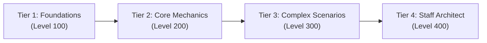

# 🗺️ Databricks Project Blueprints — Interactive Curriculum Roadmap

> **Interactive Checkbox Study Tracker & Mastery Progression**  
> **Canonical Repository**: [santoshjammi29/azure-databricks-project-blueprints](https://github.com/santoshjammi29/azure-databricks-project-blueprints) | **Ecosystem**: [moderndataengineer.uk](https://moderndataengineer.uk)  
> **Total Exercises & Drills**: `10` | **Primary Pillar**: `Databricks Platform & Lakehouse`

---

## How to Use This Roadmap

1. **Fork this repository** to your personal GitHub account.
2. Work through the modules in sequence or target specific architectural topics.
3. Check off boxes (`- [x]`) as you complete each exercise, drill, or notebook.
4. Commit and push your progress to your personal branch to track your career journey!

```
Progress: [ ] 0 / 10 Completed (0.0%)
```

---

## Curriculum Structure: The 4 Mastery Tiers



### 🟡 Tier 2: Core Mechanics & Implementation (Level 200)
> Production pipeline patterns, schema validation, standard transformations, and unit tests.

- [ ] `azure-databricks-project-blueprints-curriculum-topics` — [Topics Directory: Databricks Project Blueprints](topics/README.md) `Level 200`

### 🔴 Tier 4: Production Hardening, FinOps & Staff Architecture (Level 400)
> Enterprise trade-offs, cross-cloud DR, zero-trust security, and FinOps cost optimization.

- [ ] `azure-databricks-project-blueprints-common` — [Project: Common](src/common) `Level 400`
- [ ] `azure-databricks-project-blueprints-project1_omnichannel_retail` — [Project: Project1 Omnichannel Retail](src/project1_omnichannel_retail) `Level 400`
- [ ] `azure-databricks-project-blueprints-project2_realtime_fraud` — [Project: Project2 Realtime Fraud](src/project2_realtime_fraud) `Level 400`
- [ ] `azure-databricks-project-blueprints-project3_warehouse_modernization` — [Project: Project3 Warehouse Modernization](src/project3_warehouse_modernization) `Level 400`
- [ ] `azure-databricks-project-blueprints-doc-00_platform_architecture_security` — [Architecture: 00 Platform Architecture Security](docs/00_platform_architecture_security.md) `Level 400`
- [ ] `azure-databricks-project-blueprints-doc-01_omnichannel_retail_lakehouse` — [Architecture: 01 Omnichannel Retail Lakehouse](docs/01_omnichannel_retail_lakehouse.md) `Level 400`
- [ ] `azure-databricks-project-blueprints-doc-02_realtime_payments_fraud_aml` — [Architecture: 02 Realtime Payments Fraud Aml](docs/02_realtime_payments_fraud_aml.md) `Level 400`
- [ ] `azure-databricks-project-blueprints-doc-03_legacy_warehouse_modernization` — [Architecture: 03 Legacy Warehouse Modernization](docs/03_legacy_warehouse_modernization.md) `Level 400`
- [ ] `azure-databricks-project-blueprints-doc-04_senior_interview_defense_matrix` — [Architecture: 04 Senior Interview Defense Matrix](docs/04_senior_interview_defense_matrix.md) `Level 400`

---

## Suggested Study Schedules

| Schedule | Pace | Target Audience | Focus |
|---|---|---|---|
| **4-Week Sprint** | 5-6 drills / day | Interview Prep / Fast Track | Focus on Tier 2 & Tier 3 core drills |
| **8-Week Deep-Dive** | 2-3 drills / day | Full Technical Mastery | Complete all 10 exercises + tests |
| **12-Week Staff Track** | 1-2 drills / day | Architect & Tech Lead | Deep dive into Tier 3 & Tier 4 blueprints |

---

## Sister Repositories & Ecosystem Roadmaps

Explore interactive roadmaps across all 14 pillars of the lakehouse ecosystem:
- [Modern Data Engineer Central Hub](https://moderndataengineer.uk)
- [Databricks Handbook](https://github.com/santoshjammi29/databricks-handbook)
- [PySpark Handbook](https://github.com/santoshjammi29/pyspark-handbook)
- [SQL Handbook](https://github.com/santoshjammi29/sql-handbook)
- [dbt Handbook](https://github.com/santoshjammi29/dbt-handbook)
- [Streaming Handbook](https://github.com/santoshjammi29/streaming-handbook)
- [DataOps & CI/CD Handbook](https://github.com/santoshjammi29/dataops-cicd-handbook)
- [System Design Handbook](https://github.com/santoshjammi29/data-system-design-handbook)
- [Interview Handbook](https://github.com/santoshjammi29/data-engineering-interview-handbook)
- [Security Handbook](https://github.com/santoshjammi29/security-handbook)
