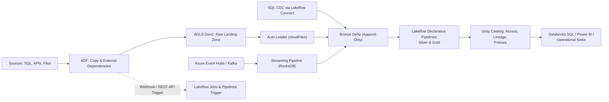

# Common Platform Architecture, Security & Governance Baseline

## 1. Architectural Topology: ADF vs. Lakeflow Division of Responsibilities

### Responsibility Matrix
- **Azure Data Factory (ADF)**: Owns external network traversal, hybrid on-premises connectivity via Self-Hosted Integration Runtimes (SHIR), scheduling external dependencies, and land-and-drop ingestion into ADLS Gen2.
- **Lakeflow Jobs & Declarative Pipelines**: Owns all internal Lakehouse ETL/ELT, data cleansing, SCD Type 2 historization, dimensional modeling, and metric calculations over Databricks Serverless Compute and Photon.
- **Retry Invariant**: Retries are assigned to a single clear owner. ADF calls the Databricks Job Activity using run-and-wait without internal pipeline loops, preventing multi-tier retry multiplication storms.

---

## 2. Shared Security, Identity & Zero-Trust Design

### Identity & Storage Access
- **Managed Identities**: Workloads authenticate using Azure Entra ID User-Assigned Managed Identities. Storage keys and SAS tokens are strictly forbidden.
- **Unity Catalog Storage Credentials**: Access to ADLS Gen2 is brokered via the **Azure Databricks Access Connector** paired with Managed Identities assigned `Storage Blob Data Contributor` on specific container scopes.
- **Storage Tiering**: Standard Lakehouse tables reside in **Unity Catalog Managed Tables** (where UC governs both metadata and file lifecycles). External Locations and Volumes (`/Volumes/catalog/schema/volume_name`) are restricted to raw landing zones and unstructured files.

### Network Isolation
- **VNet Injection**: Workspaces are injected into custom Azure Virtual Networks with private subnets.
- **Secure Cluster Connectivity (No Public IP / NPIP)**: Compute nodes have zero public IP addresses. Control-plane-to-compute-plane traffic traverses **Azure Private Link**.
- **Managed Private Endpoints**: ADF connects to ADLS Gen2 and Key Vaults through Azure Private Endpoints within an ADF Managed Virtual Network.

### Governance, ABAC & Lineage
- **3-Level Namespace**: Standardized hierarchy `catalog.schema.table_or_volume`.
- **Fine-Grained Security**: Dynamic Column Masking (SHA-256 for PII/PAN) and Dynamic Row-Level Security (RLS) evaluated at query time via SQL UDFs.
- **Automated Lineage**: Runtime lineage captured in `system.access.table_lineage` down to the column level.
- **Compliance Security Profile (CSP)**: Enforced for regulated workspaces (PCI-DSS, HIPAA, DORA), ensuring encrypted scratch disks, automated security monitoring, and hardened images.

---

## 3. Reliability, FinOps & DevOps Lifecycle

- **Replay Safety**: Ingestion streams advance source watermarks only after target Delta commits succeed. Delta Lake ACID logs guarantee idempotency on retries.
- **FinOps via System Tables**: Mandatory tagging (`cost_center`, `workload_type`) attributed via `system.billing.usage` and `system.query.history`.
- **Declarative Automation Bundles (DABs)**: All infrastructure, code, jobs, and pipeline definitions are declared in YAML and promoted across `dev`, `staging`, and `prod` via GitHub Actions CI/CD using Service Principals.
