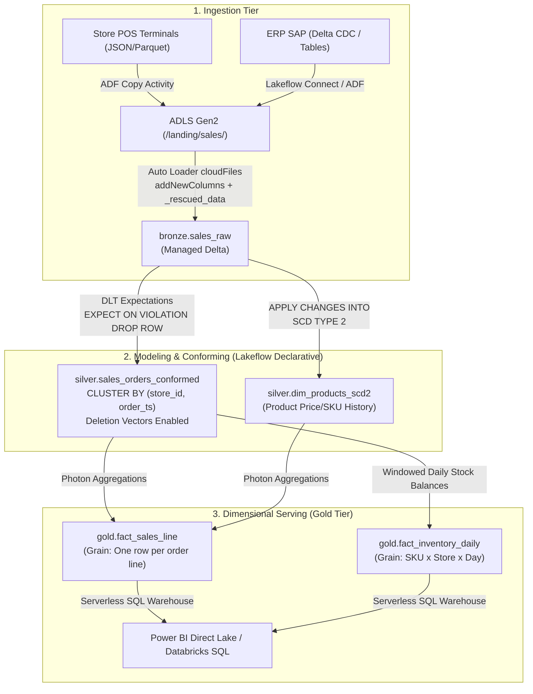

# Blueprint 1: Omnichannel Retail Sales & Inventory Lakehouse

## 1. Executive Summary & Scale
- **Business Problem**: Retail operations struggled with fragmented inventory visibility across 1,800 brick-and-mortar stores and 3 global e-commerce regions, leading to frequent out-of-stock events and delayed gross margin reconciliation.
- **Scale**: **8 TB/day** raw ingestion; $> 60\text{M}$ transaction line items daily; 450,000 active SKUs.
- **Freshness SLA**: E-commerce sales: $< 15\text{ minutes}$; Store POS batches: hourly; Warehouse stock: every 4 hours; Executive dashboards: sub-2-second query latency.

---

## 2. End-to-End Architecture Flow

### DataOps Implementation
1. **Landing & Auto Loader**: ADF lands hourly store batches. Auto Loader (`cloudFiles`) processes new files into `bronze.sales_raw` with `schemaEvolutionMode = 'addNewColumns'` and unexpected fields captured in `_rescued_data`.
2. **Lakeflow Declarative Pipelines**:
   - Cleanses records and enforces expectations (`EXPECT (order_id IS NOT NULL) ON VIOLATION FAIL UPDATE`).
   - Historizes product and store master updates into SCD Type 2 tables via `APPLY CHANGES INTO`.
   - Uses **Liquid Clustering** (`CLUSTER BY (store_id, order_date)`) and **Deletion Vectors** (`delta.enableDeletionVectors = true`).
3. **Gold Serving**:
   - `gold.fact_sales_line`: Grain is **one row per line item**. Returns and cancellations are handled as compensating transactions with negative values referencing `original_order_id`.
   - `gold.fact_inventory_daily`: Grain is **one row per SKU per Store per Day**.
   - Power BI queries Gold via **Databricks SQL Serverless** in Direct Lake mode.

---

## 3. Senior Architectural Decisions & Trade-Offs

### Fact Grain & Return Handling
- *Decision*: Never overwrite past sales records when returns or cancellations occur. Modifying historical rows breaks financial reconciliation and audit trails.
- *Implementation*: Returns are committed as new fact lines with negative quantities, linked by an `original_order_id` foreign key.

### Liquid Clustering vs. Hive Partitioning
- *Decision*: Migrated from `PARTITIONED BY (store_id, date)` to **Liquid Clustering (`CLUSTER BY (store_id, order_date)`)**.
- *Rationale*: Hive partitioning created over 120,000 tiny files, causing driver metadata planning bottlenecks. Liquid Clustering uses Hilbert-curve layouts to maintain optimal 256–512 MB file sizes and allows clustering keys to evolve via `ALTER TABLE` without rewriting historical data.

### Additive vs. Breaking Schema Drift
- *Additive*: New optional columns are automatically added via Auto Loader's `addNewColumns`.
- *Breaking*: Type mutations or missing mandatory keys trigger an automated quarantine into `_rescued_data`, sending an alert without interrupting pipeline execution.

---

## 4. Six Core Interview Talking Points

1. **Source Volume**: 8 TB/day, 60M line items, 1,800 retail stores, 450,000 SKUs.
2. **Freshness SLA**: 15 minutes e-commerce, 1 hour physical stores.
3. **Exact Ownership**: Designed end-to-end Medallion pipeline, authored DLT expectation suites, implemented Liquid Clustering, and tuned DBSQL Serverless caching.
4. **Design Trade-Off**: Chose Liquid Clustering over traditional partitioning to eliminate small-file sprawl and avoid costly full-table Z-Order rewrites.
5. **Production Failure & Recovery (STAR)**:
   - *Situation*: Hourly sales merges failed with `ConcurrentAppendException` during Cyber Monday when inventory replenishment and online reconciliation wrote to `silver.sales_orders` simultaneously.
   - *Task*: Eliminate write conflicts and restore hourly pipeline execution without serializing the two jobs.
   - *Action*: Enabled **Deletion Vectors** for Merge-on-Read and added deterministic clustering key filters (`store_id`, `order_date`) inside the `MERGE ON` condition, enabling Delta to prune disjoint file sets.
   - *Result*: Write lock conflicts fell to zero; merge execution time decreased by **72%**; cloud compute costs fell by **$2,400/month**.
6. **Measured Outcomes**:
   - Pipeline SLA compliance reached **99.8%**.
   - P95 BI query response improved from 14s to **1.6s** via Photon caching.
   - Total storage footprint decreased by **38%** through automated predictive compaction.
