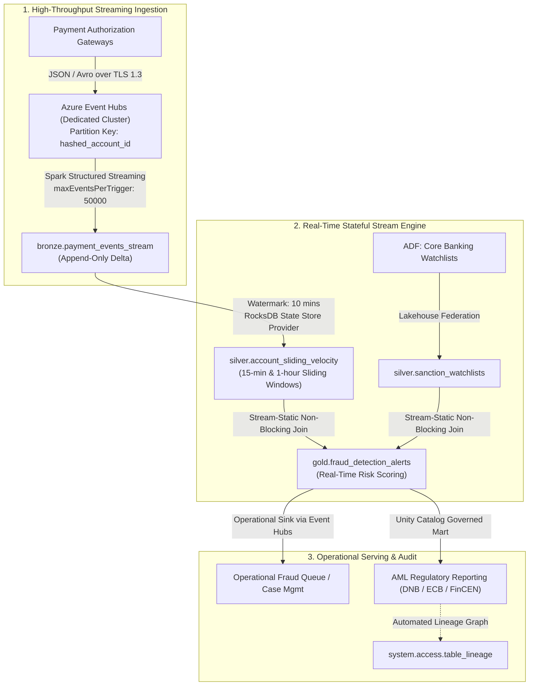

# Blueprint 2: Real-Time Payments Fraud & AML Monitoring

## 1. Executive Summary & Scale
- **Business Problem**: High-frequency credit card fraud and Anti-Money Laundering (AML) smurfing patterns caused substantial chargeback losses and regulatory reporting fines. Operational teams needed sub-3-second fraud alerts without losing audit traceability.
- **Scale**: **12,000 to 45,000 transactions/second** peak; 120 Million payment authorization events daily; $> \$400\text{B}$ annual transaction volume.
- **Freshness SLA**: Real-time fraud alert delivery: **$< 3\text{ seconds}$**; Regulatory AML audit trail commitment: $< 60\text{ seconds}$.

---

## 2. End-to-End Architecture Flow

### DataOps Implementation
1. **Streaming Ingestion**: Azure Event Hubs ingests payment events partitioned by `hashed_account_id`. Databricks Structured Streaming captures events into Bronze with enqueued offset metadata.
2. **Stateful Silver Stream**:
   - Uses **RocksDB State Store with changelog checkpointing** to maintain 15-minute and 1-hour sliding velocity windows.
   - Enforces an explicit **10-minute event-time watermark** to prune state and drop expired events safely.
3. **Gold Detection & Alert Egress**:
   - Evaluates velocity anomalies and executes stream-static joins against sanctions watchlists.
   - Pushes alerts downstream via an idempotent event handler using deterministic deduplication keys (`event_id + rule_id`) to prevent duplicate operational alerts.
4. **Security & Lineage**: Cardholder PAN and PII are masked at query time using SHA-256 with Azure Key Vault salt. Unity Catalog logs automated lineage in `system.access.table_lineage`.

---

## 3. Senior Architectural Decisions & Trade-Offs

### Watermarking vs. State Store Memory Bloat
- *Decision*: Configured an explicit 10-minute watermark (`withWatermark("event_time", "10 minutes")`).
- *Rationale*: Without watermarking, stateful windows hold accounts indefinitely in memory. Switching to off-heap **RocksDB** shifted state from the JVM heap to local NVMe SSDs, allowing the system to scale to tens of millions of keys without GC pauses.

### Dual-Sink Idempotency
- *Decision*: Delta commits are transactional, but external alert queues (Event Hubs / webhooks) cannot participate in the Delta two-phase commit.
- *Implementation*: Attached a deterministic deduplication key (`event_id + rule_id`) to every alert. The downstream operational consumer maintains an idempotent 1-hour Redis cache buffer, safely dropping duplicate deliveries caused by micro-batch stream replays.

### Hot Partition Skew Mitigation
- *Decision*: Never partition streaming state by `merchant_id`. High-volume global merchants caused massive executor stragglers.
- *Implementation*: Stream state is pinned strictly to `hashed_account_id`, while merchant risk profiles are referenced via low-cardinality broadcast tables.

---

## 4. Six Core Interview Talking Points

1. **Source Volume**: 120M events/day, peak 45,000 events/sec, 180 GB/hour streaming throughput.
2. **Freshness SLA**: $< 3\text{ seconds}$ from transaction initiation to fraud alert.
3. **Exact Ownership**: Architected Structured Streaming pipeline, tuned RocksDB state management, implemented dual-sink idempotent egress, and configured Unity Catalog dynamic masking.
4. **Design Trade-Off**: Chose **Structured Streaming micro-batch (500ms trigger)** over continuous processing. Continuous processing lacked support for stateful aggregations and joins; 500ms micro-batches over Photon met the 3-second SLA while preserving full ACID transaction semantics.
5. **Production Failure & Recovery (STAR)**:
   - *Situation*: Default in-memory state store crashed the driver with `OutOfMemoryError` every 40 minutes during peak holiday volume, creating a 3-million event backlog in Event Hubs.
   - *Task*: Stabilize driver and executor memory and clear the stream backlog without dropping transactions.
   - *Action*: Switched the state store provider to **RocksDB** (`RocksDBStateStoreProvider`), enabled changelog checkpointing, tightened event-time watermarks from 60 to 10 minutes, and capped `maxEventsPerTrigger = 50000`.
   - *Result*: Driver memory stabilized at **32% flatline**; the 3M event backlog cleared in **11 minutes**; pipeline availability returned to **99.99%**.
6. **Measured Outcomes**:
   - Alert latency: **1.8s P95** (well within 3s SLA).
   - Stream recovery time (RTO): $< 45\text{s}$ from worker restart.
   - Zero plain-text PAN exposure across non-production environments.
