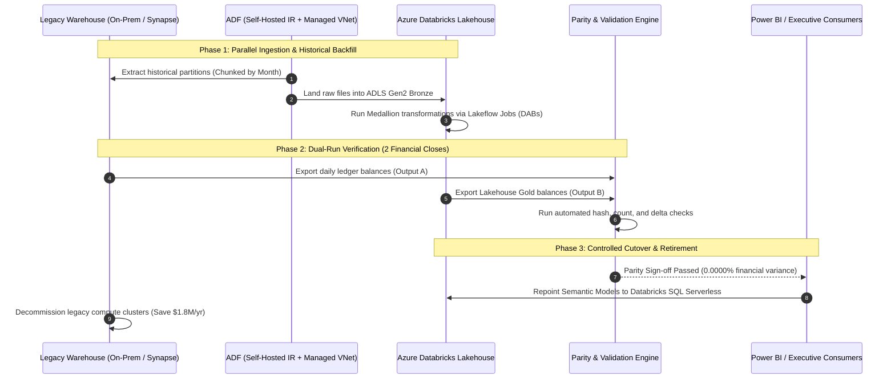

# Blueprint 3: Legacy Warehouse Modernization & Controlled Cutover

## 1. Executive Summary & Scale
- **Business Problem**: A legacy monolithic on-premises data warehouse (Teradata / SSIS / Synapse) suffered from $1.8M in annual licensing costs, severe morning query queue congestion, and high operational fragility.
- **Scale**: **35 TB** historical warehouse data; 450 stored procedures / ETL pipelines; 85 downstream BI reports and financial ledger extracts.
- **Cutover SLA**: Zero downtime for business consumers; dual-run parallel validation across two complete month-end financial close cycles; variance $< 0.0001\%$ on certified financial KPIs.

---

## 2. End-to-End Architecture Flow

### DataOps Implementation
1. **Topological Wave Migration**: Sequenced 450 legacy tables into 4 dependency waves: (1) Reference/Master Data, (2) Sales Reporting, (3) Supply Chain, (4) Financial Ledger.
2. **Ingestion & Hydration**: Parameterized ADF copy pipelines with Self-Hosted Integration Runtimes (SHIR) extracted chunked monthly historical partitions over ExpressRoute, writing checksum manifests.
3. **Automated Dual-Run Parity Engine**:
   - Refactored legacy procedural logic into set-based PySpark and ANSI SQL declarative Lakeflow pipelines.
   - Built an automated reconciliation framework comparing row counts, checksum hashes, and financial variances daily.
4. **DevOps & DABs**: Deployed all Lakeflow Jobs, pipelines, and permissions via Declarative Automation Bundles (`databricks.yml`) across `dev`, `staging`, and `prod` with GitHub Actions and Azure Service Principals.

---

## 3. Senior Architectural Decisions & Trade-Offs

### Dependency Graph Phasing vs. Business Unit Migration
- *Decision*: Migration was partitioned strictly by the **directed acyclic dependency graph**, not by business department.
- *Rationale*: Migrating by business department (e.g. Finance first) fails because Finance depends on Master Dimensions, Sales, and Supply Chain. Layer 0 foundational tables migrated first, followed by dependent analytical marts.

### Resolving Metric Divergence When Legacy Logic Was Flawed
- *Decision*: When the new Lakehouse revealed a 0.4% discrepancy in financial metrics, investigation proved that the legacy stored procedure contained an accidental Cartesian join that double-counted adjustment entries.
- *Resolution*: Rather than copying the legacy bug, we preserved the legacy calculation behind a temporary feature flag (`legacy_accounting_mode = true`). We presented query plan diffs to the Chief Accounting Officer, gained formal approval, and retired the legacy defect.

### Idempotent Backfill & Rollback
- *Decision*: ADF updated extraction watermarks in control tables only after target Delta commits succeeded.
- *Implementation*: Used **Delta Lake Time Travel** (`RESTORE TABLE ... TO VERSION AS OF`) to achieve instant zero-loss rollback during network interruptions without re-running entire multi-day extracts.

---

## 4. Six Core Interview Talking Points

1. **Source Volume**: 35 TB historical data, 450 pipelines, 12,000 source tables.
2. **Freshness SLA**: Daily batch completion accelerated from 08:30 AM to **03:15 AM** (a 5-hour SLA improvement).
3. **Exact Ownership**: Spearheaded technical migration strategy, designed automated dual-run reconciliation engine, authored DABs CI/CD workflows, and led financial parity audits.
4. **Design Trade-Off**: Chose **Dual-Run Parallel Execution with automated reconciliation** over Big-Bang cutover. Dual-running cost an extra $4,500/month in temporary compute for 60 days, but eliminated operational risk of financial misstatements.
5. **Production Failure & Recovery (STAR)**:
   - *Situation*: An ExpressRoute network failure interrupted an 85%-completed 20-TB historical backfill, leaving duplicate ledger records in the landing zone.
   - *Task*: Recover the backfill without restarting the 48-hour extract from scratch and ensure no duplicates entered Silver.
   - *Action*:
     1. Used **Delta Lake Time Travel** (`RESTORE TABLE prod_catalog.bronze.ledger_raw TO VERSION AS OF <pre_backfill_version>`) to revert to a clean state in 4 seconds.
     2. Refactored the ADF pipeline to extract in discrete monthly chunks tagged with MD5 row hashes.
     3. Implemented a deterministic deduplication step using `dropDuplicates(["transaction_id", "source_sequence_no"])`.
   - *Result*: Clean backfill completed successfully; zero duplicate records propagated downstream; established a permanent rollback playbook for subsequent migration waves.
6. **Measured Outcomes**:
   - **100.0000%** financial parity achieved across 2 full fiscal close cycles.
   - Eliminated **$1.8M/year** in legacy hardware licensing and maintenance.
   - Daily reporting refresh time cut by **62%**, consistently meeting morning business SLAs.
